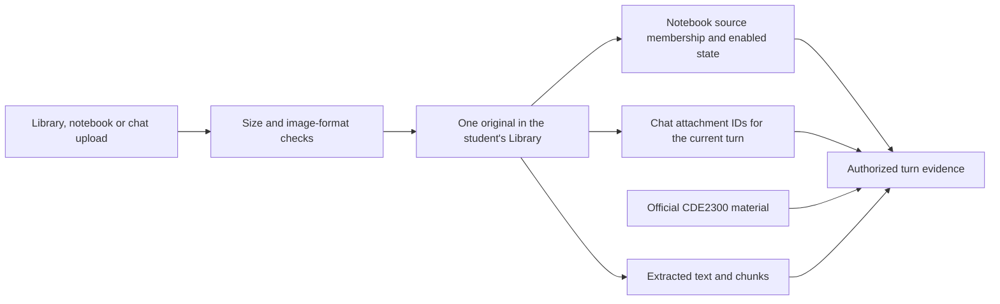

# RAG architecture

This describes **actual** retrieval behaviour in Integrate-Bedrock. FastAPI
owns source authorization. Retrieval acquires evidence from that allowed
scope. AgentCore / Strands reasons over the composed brief; it does not search
the Knowledge Base or student S3.

```text
                         Student
                            │
                            ▼
                        Streamlit
                            │
                            ▼
                         FastAPI
                            │
               Cognito identity/ownership
                            │
                            ▼
                     DSQL application state
                            │
                   selected sources only
                            │
              deterministic retrieval gate
                            │
                ┌───────────┴───────────┐
                │ skip                  │ retrieve
                ▼                       ▼
        conversation memory     Course materials
        + <=6 recent turns              │
        + <=3000 hist tokens            │
                                Bedrock KB Retrieve
                                + student-source retrieve
                                + ownership / selected-source checks
                                        │
                                        ▼
                              Unified [S#] excerpts (≤4, ~8k chars)
                            │
                            ▼
              FastAPI runtime rules + untrusted evidence
                            │
                            ▼
              AgentCore fast_chat (one FastAPI invoke; Haiku span count
              needs live traces)
                            │
              rare: needs_source_retrieval after skip, or needs_sources
              (opt-in) after a skip with nothing retrieved
                            │
                            ▼
              FastAPI retrieves once, one FastAPI Haiku retry
              (provisional first result is not persisted)
```

A rare accuracy fallback runs only when the deterministic gate skipped
retrieval, selected sources exist, and Haiku sets
`needs_source_retrieval=true`. FastAPI owns that retrieve. AgentCore still
has `tools=[]` and cannot search KB, S3, or DSQL. Maximum two Haiku calls.

### First-pass evidence scope (one owner)

`backend/coaching/evidence_scope.py` owns the first-pass decision of which
evidence a turn may use (course catalog, the student's own files, both or
neither), the expected response mode and the cues that fired.
`decide_first_pass_scope(ScopeInputs) -> ScopeDecision` is a pure function over
plain values. It imports no `boto3`, provider, settings or store module
(`tests/domain/test_evidence_scope.py` walks its imports). Two callers use it:
`_prepare_authoritative_turn` in `backend/coaching/execution.py` and
`gate_decision` in `scripts/evals/lib/gate.py` (re-exported by
`scripts/evals/evaluate_retrieval.py`), so the offline gate
numbers run the production rules and not a copy.

Precedence, in the order the rules run:

1. `resolve_mode_policy` on the message, titles and filenames.
2. The legacy Lecture help intent sets `high_confidence_source`, `qa`, and
   retrieves for course questions and other substantive turns. Improve my
   design uses `qa` for its non-progression reply contract and retrieves when
   existing course or selected-source cues call for evidence. Both intents
   bypass Thinking Path navigation overrides. Project Coaching sets the mode
   to `coaching`.
3. Current-stage status clears the evidence scope and sets `qa`, no retrieve.
4. Stage progression, terminal completion or workflow meta-guidance (the
   latter only when it is not a status request) clears the scope and sets
   `coaching`, no retrieve.
5. A private-attachment question narrows the scope to the attachments. It runs
   after a clear too, so it still forces retrieval while the kept scope is
   empty. Improve also uses the files attached to the current turn when a
   critique directive does not name them. A course comparison can draw on
   both scopes.
6. Missing image Q&A: every selected source is an image, none loaded, and the
   message is an information request. It forces retrieval, stamps `qa` and
   fails closed.
7. `force_retrieval` with any originally selected source forces retrieval,
   even after a clear.
8. Course catalog: retrieval is needed and the turn is not attachment-only,
   status, progression or workflow guidance, and it is legacy Lecture help or a
   course-catalog cue fired.
9. Local course-intent promotion (Laya), only for an eligible ambiguous turn.
10. Upload retrieval policy (below).

What stays in `execution.py` because it reads state the pure function cannot
see: authorization, image-byte loading (`image_inputs_for_sources`, passed in
as `image_bytes_resolved`), `is_locked_course_source` (passed in as
`is_course_library`), the Laya model call, its cutoffs and course titles, the
`FAST_CHAT_UPLOAD_RETRIEVAL_ENABLED` read (taken after the model call, as
before), the snapshot replacements, hydration and its failure handling, the
`needs_sources` check that depends on hydrated `retrieval_sources`, and every
`record_field` write. `execution.py` calls the module once. When the module
reports `course_intent_eligible` and its own classifier scores at or above the
cutoff, it calls the module again with `course_intent_promoted=True`, so the
promotion lands before the upload rule exactly as before. The module returns
cues; `execution.py` records `current_stage_status_request`,
`stage_progression_request` or `workflow_skips_retrieval`, and
`attachment_retrieval_scoped` before the model call, then
`local_course_intent_retrieval` and `upload_retrieval_policy` after it, then
`retrieval_gate_ms`, `retrieval_required` and `mode_policy_intent`. The first
four names are not in the perf allow-list, so the accumulator drops them with a
`turn_perf_rejected_field` warning; the calls and their order are unchanged.

The offline eval cannot supply four inputs and holds them at the values the
old gate assumed: image bytes loaded, `force_retrieval` false, no locked
course-library rows, and no frozen Deep Review history. The model-driven
second chance stays outside the gate.

Improve searches using the same authorized source catalog and citation
validation as Design coaching. The first search and any retry omit the saved
stage and the staged learning summary from their retrieval inputs. An Improve
reply saves validated citations with the message independently of educational
assessment, so sources remain inspectable when the student reopens the chat.

### `needs_sources` (first-call source check, opt-in)

The regex gate misses course questions that name no cue word ("what questions
do we ask in the JTBD interview"). With `FAST_CHAT_NEEDS_SOURCES_ENABLED=true`
(default **false**) the first Fast Chat call may also return `needs_sources`:

1. `_prepare_authoritative_turn` stamps `source_need_check=true` on the request
   when the gate searched nothing and no override fixed the evidence scope.
   Stage status, stage navigation, meta-guidance, private-attachment scope,
   forced retrieval, Lecture Help and missing-image turns are never stamped.
   A turn searched by the opt-in upload retrieval policy ("Student-upload
   RAG" below) has searched, so it is not stamped either.
   The stamp is server-owned; a client value is overwritten.
2. For stamped turns the backend runtime rules (`backend/prompts/composer.py`)
   add a SOURCE CHECK paragraph that tells the model when to set the flag and
   to keep its first reply free of course-specific facts. With
   `FAST_CHAT_SOURCE_CHECK_TITLES_ENABLED=true` (default **false**, takes
   effect only on stamped turns) a COURSE MATERIAL TITLES block follows: the
   notebook's Lecture Notes and Readings titles plus "a question about a
   concept, framework, method or term covered by these titles needs sources;
   navigation, UI help, greetings and the student's own project reasoning do
   not". Titles come from `snapshot.visible_sources` filtered by
   `is_locked_course_source`, the same course set a flagged turn hands to the
   Knowledge Base (shared `course/lectureNotes/` and `course/readings/`
   catalog, or locked rows synced from the local folder), so the turn does no
   extra I/O. A title is the filename without its extension; Lecture Notes come
   first, natural order, at most 20 titles of at most 80 characters. The
   server-owned `course_material_titles` request field carries them; a client
   value is overwritten, the retry clears it, and the idempotency fingerprint
   excludes it. The block is in the per-turn runtime rules
   (`trusted_instructions`), after the fast-chat cache point, so it is not
   cached. With the 10 current course files it is 793 characters (about 199
   tokens at 4 characters per token, 265 at the planner's 3).
3. The provider honours the flag only on a stamped request and only when the
   returned mode is Q&A. A model that volunteers it (or text that induces it)
   cannot start a second call. A flagged **coaching** turn is ignored: it is
   not retried, so its first reply, assessment and stay/advance
   recommendation are persisted as without the setting. The retry would
   otherwise rewrite the turn into a fail-closed course turn and discard
   that assessment. The SOURCE CHECK text tells the model to use mode qa when
   it sets the flag. The ignored case is recorded as
   `fast_chat_needs_sources_ignored_coaching` in `coach_turn_perf`.
4. When the flag is true, `_maybe_rag_fallback` retrieves from selected
   sources **and the course catalog**, clears `source_need_check`, sets
   `retrieval_required` and `allow_model_knowledge=false`, and runs the one
   retry. The first result is not persisted. If that retrieve fails, the retry
   still runs with the "retrieval unavailable" context so the reply states the
   evidence gap.

Limit: when the flag is true but nothing can be retrieved (no course library
synced and no selected source, or the two-invoke budget is spent), the retry is
skipped and the brief first reply, written to assert no course facts, is shown
and persisted. It is not an evidence-gap reply. A flagged turn with a failed
retrieve does get an evidence-gap reply. Authoring one for the skipped case is
a possible follow-up.

The SOURCE CHECK text says no excerpts were retrieved, while the runtime
`fast_chat.md` Q&A section says FastAPI already retrieved. The SOURCE CHECK
text states that it overrides that note. Whether the model sets and clears the
flag as intended can only be checked in a live canary. The opt-in
`evaluate_retrieval.py --live-model --max-live-calls N` run measures the real
flag rate, wrong-skip, false-retrieve and extra calls on the 295 gate messages
before a canary (see `docs/RETRIEVAL_EVAL.md`).

`needs_sources` and `needs_source_retrieval` coexist. They share one retry, one
budget (two invokes per turn) and one persistence path. `needs_source_retrieval`
keeps its narrower meaning (selected sources exist and were skipped) and its
required place in the wire contract. `needs_sources` is a superset trigger that
also reaches the course catalog and works when nothing is selected. A first-call
answer is already written without evidence whenever either flag is true, so a
retry is needed either way; the new flag adds a broader trigger and does not
remove the second call. With the setting off the prompt, the retry rules and
the wire behaviour are as before.

## Authority

| Layer | Owns |
|---|---|
| FastAPI / application services | Identity, notebook ownership, selected source IDs, retrieval scope, workflow |
| DSQL / SQLite | Authoritative transcript and application state |
| S3 | File bytes (canonical course objects and owner-scoped student objects) |
| Bedrock Knowledge Base | Semantic retrieve over official course material only |
| Local student retriever | Notebook-scoped chunks of extracted student text |
| AgentCore / Strands | Pedagogical reasoning over authorized `[S#]` evidence. No KB or S3 tools. One FastAPI `fast_chat` invoke for normal chat. Live traces must confirm event-loop/Haiku span count. |

The coach cannot choose sources. Prompt instructions are not authorization.

## Course material RAG

Official course PDFs have one canonical production copy under shared S3 keys
such as `course/lectureNotes/` and `course/readings/`. Bedrock Knowledge Base
indexes that copy. The application does not paste entire PDFs into prompts.

Shared course files appear in the student UI as **virtual catalog sources**.
They are not duplicated into each notebook's DSQL `sources` rows. Virtual
rows have empty `extractedText` on purpose. Course evidence must come from
Bedrock Knowledge Base `Retrieve`. A missing or empty `KNOWLEDGE_BASE_ID` is
an evidence gap, not a fallback onto `LocalChunkRetriever`. The local
retriever never ranks the display placeholder
`[This source is stored but has no analyzable text.]` as retrieved evidence.

The course catalog joins a turn only when the gate classifies the message as a
retrieve and the classifier reports a cue in `_COURSE_CATALOG_RETRIEVAL_CUES`
(`backend/coaching/evidence_scope.py`). The cues are `conservative_course_question`,
`week_or_session`, `course_grounding`, `according_to_source`,
`what_source_says`, `based_on_source`, `material_noun`, `compare_to_source` and
`definitional_question`. The last one covers impersonal concept questions such
as "what is a creative matrix" or "explain the prioritisation matrix" that name
no week, lecture or source. Messages with a first- or second-person pronoun
never count as definitional. The same rule also fires for an impersonal
question that is not about the course ("what is the capital of Australia"), so
some off-topic questions now reach course search, which can return nothing and
produce an evidence gap. See `docs/RETRIEVAL_EVAL.md` for the measured effect.

`configured_context_retriever()` always returns `CompositeContextRetriever`.
Mock mode and an empty Knowledge Base id inject `knowledge_base=None` so
shared `course/` sources cannot become fake local chunks. Live providers with
a Knowledge Base id inject `BedrockKnowledgeBaseRetriever`.

`CompositeContextRetriever` runs the Knowledge Base call and the student-upload
retrieval in parallel when a turn selects both (the Knowledge Base call runs on
a worker thread with the turn's context copied, local ranking runs on the
caller). It then reserves result slots so course hits cannot crowd out student
uploads: of the `FAST_CHAT_RETRIEVAL_MAX_CHUNKS` (default 4) slots,
`FAST_CHAT_RETRIEVAL_COURSE_SLOTS` (default 2) are for course hits and the rest
(default 2) for uploads. A side that returns fewer hits releases its unused
slots to the other side. Course chunks stay ahead of upload chunks in the
prompt.

`BedrockKnowledgeBaseRetriever` calls **Retrieve only** (never
RetrieveAndGenerate). Production Knowledge Base `JUQNP8AZAZ` is type
**MANAGED**, so Retrieve uses `managedSearchConfiguration`. Classic VECTOR
Knowledge Bases keep `vectorSearchConfiguration`. `compose.prod.yaml` sets
`KNOWLEDGE_BASE_TYPE=MANAGED`. Sending `vectorSearchConfiguration` to a
MANAGED Knowledge Base raises `ValidationException` and becomes
`course_retrieval_unavailable`.

When selected course sources have `course_material_id`
values, Retrieve sends a metadata filter:

```text
course_material_id IN selected_course_material_ids
```

(or `equals` for a single id). Expected KB metadata attribute:

| Attribute | Type | Example |
|---|---|---|
| `course_material_id` | string | `lecture_week_02_jtbd`, `reading_pixar` |

Application-owned IDs are derived from the object key. Direct files keep the
historical form (`course/lectureNotes/week_02_jtbd.pdf` →
`lecture_week_02_jtbd`). Nested directories are included so the same filename
in two folders cannot collide (`course/readings/archive/week1.pdf` →
`reading_archive_week1`). Duplicate-id detection is available via
`course_material_id_collisions`. Course sync stores the same id on locked
source metadata.

If the live Knowledge Base does not yet contain that attribute, operators must
set `KNOWLEDGE_BASE_METADATA_FILTER_MODE` explicitly:

- `required` (code default, production target after sidecar ingest): send
  `equals` for one selected `course_material_id` or `in` for several. A
  `ValidationException` or timeout is an evidence gap. There is **no**
  automatic unfiltered retry.
- `degraded_unfiltered`: one unfiltered Retrieve, then exact selected
  bucket/object-key validation. Temporary operator fallback until sidecars
  exist in the index.
- `disabled`: do not call Retrieve.

`KNOWLEDGE_BASE_STRICT_METADATA_FILTER=true` still maps to `required`. False
no longer skips the MANAGED filter.

Retrieve is optional evidence gathering: the adapter uses a wall-clock timeout
(`KNOWLEDGE_BASE_RETRIEVE_TIMEOUT_SECONDS`, default 10s, justified as twice
the previous 5s fail-closed cap and far below the 120s UI timeout),
`total_max_attempts=1`, and `numberOfResults` equal to
`KNOWLEDGE_BASE_RETRIEVE_CANDIDATES` (default 12, bounded 12 to 16). The adapter
validates every candidate (bucket, object key, non-empty text), ranks the
survivors by score, drops near-duplicates, and keeps the best
`FAST_CHAT_RETRIEVAL_MAX_CHUNKS` (default 4). Hits that fail validation never
take a kept slot. A Python future timeout does not
cancel boto; abandoned calls reuse a shared executor
(`KNOWLEDGE_BASE_RETRIEVE_EXECUTOR_WORKERS`, default 4). The executor queue is
not used as a backlog: admission is a semaphore sized to the worker count, so
excess calls fail closed immediately as `unavailable` /
`capacity_exhausted` instead of queueing ghost Retrieves.

Post-retrieval object-key **and bucket** validation is always applied. A hit
whose bucket cannot be positively confirmed against `COURSE_MATERIALS_BUCKET`
is dropped, including empty configured buckets and empty-bucket URIs such as
`s3:///course/lectureNotes/week1.pdf`. Production startup fails if a
Knowledge Base is configured without `COURSE_MATERIALS_BUCKET`. The metadata
filter is retrieval precision only. FastAPI maps surviving chunks to
request-local `[S#]` labels.

Sidecar metadata files use the Bedrock S3 data-source format. Generate them
with `scripts/sync_course_kb_metadata.py` (dry-run by default; `--confirm`
uploads). Verify local identity with
`scripts/diagnostics/check_course_kb_metadata.py`. For the S3 data source,
Bedrock expects a sibling file named `<filename.ext>.metadata.json`:

```text
s3://<COURSE_MATERIALS_BUCKET>/course/lectureNotes/Week 1 Introduction to innovation v3.pdf
s3://<COURSE_MATERIALS_BUCKET>/course/lectureNotes/Week 1 Introduction to innovation v3.pdf.metadata.json
```

```json
{
  "metadataAttributes": {
    "course_material_id": {
      "value": {
        "type": "STRING",
        "stringValue": "lecture_week_1_introduction_to_innovation_v3"
      },
      "includeForEmbedding": false
    }
  }
}
```

Live validation procedure is **documentation only** and lives in
[`KB_REQUIRED_MODE_RUNBOOK.md`](KB_REQUIRED_MODE_RUNBOOK.md). Generate
sidecars → upload (`--confirm`) → sync the data source → wait for
`COMPLETE` → local metadata verification → one `equals` Retrieve → one
`in` Retrieve → only then set
`KNOWLEDGE_BASE_METADATA_FILTER_MODE=required`. Do not treat an unfiltered
Retrieve as proof that filtered mode is live. Those live AWS steps are not
executed by this repository's pytest.

Until sidecars are ingested, set `degraded_unfiltered` explicitly on the
live env. Do not switch production off `required` as a code fix.

Live Knowledge Base `JUQNP8AZAZ` previously returned HTTPS S3 locations under
`CDE2300_course_files_export/Course_materials/...`. The student catalog
selects `course/lectureNotes/...` and `course/readings/...`. Those keys do
not match. Re-point the data source at `s3://<COURSE_MATERIALS_BUCKET>/course/`
and complete ingestion/sync. Do not map the export prefix onto catalog keys
in application code.

Production with `COURSE_MATERIAL_SYNC_ENABLED=true` requires
`KNOWLEDGE_BASE_ID`, `KNOWLEDGE_BASE_REGION` (or `AWS_REGION`), and
`COURSE_MATERIALS_BUCKET`. Empty Knowledge Base id is valid only for mock
tests and local folder copies that still have extracted text.

## Student-upload RAG

Student files stay out of the shared course Knowledge Base. Storage is
owner- and notebook-scoped:

```text
users/<user-id>/notebooks/<notebook-id>/sources/<source-id>/raw|derived
```

`LocalChunkRetriever` searches only authenticated user + current notebook +
currently selected source IDs. There is no global student vector namespace.
Chunking is deterministic (~1,800 characters, overlap, per-source diversity).
Selected student sources are hydrated from `derived/chunks.v1.json` when that
artifact is valid; otherwise extracted text is chunked at query time.
Normal fast chat then keeps at most 4 chunks / 8,000 characters. Student
uploads keep extracted text; they do not use the shared course Knowledge Base.

### Upload retrieval policy (opt-in)

`FAST_CHAT_UPLOAD_RETRIEVAL_ENABLED` (default false) searches the selected
student uploads on turns the regex gate skipped. The excerpt ranking
(`LocalChunkRetriever`) is local and makes no Bedrock or Knowledge Base call.
Loading the uploads is not always local: on a turn the gate skipped it can add
one S3 GET per selected upload on a chunk-cache miss (the chunk artifact), or
on every such turn when the source falls back to extracted text (no
`extracted_text_sha256`, or a missing or invalid artifact; that read is not
cached). The latency and cost of those reads are not measured.
`_prepare_authoritative_turn` applies
`wants_student_upload_retrieval` (`backend/coaching/evidence_scope.py`, inside
`decide_first_pass_scope`) after the course-catalog step. It fires only when
all of these hold:

- the setting is on and the gate decided no retrieval;
- at least one selected or attached source left after scoping is the
  student's own and not an image (`is_searchable_student_upload`, applied by
  `searchable_student_uploads` in `execution.py`: course library rows and
  image sources are dropped; images reach the model as image input);
- no gate override fixed the evidence scope. Navigation reuses the existing
  overrides: current-stage status, stage progression or terminal completion,
  and `workflow_skips_retrieval` (meta-guidance). These turns already clear
  the selected sources. Lecture Help, forced retrieval, private-attachment
  questions and missing-image Q&A already retrieve or are fixed too;
- the turn is not chit-chat (`is_chit_chat`): a bare acknowledgement from the
  set recent-message grounding already uses (`ok`, `okay`, `thanks`, `yes`,
  `no`, `sure`, trailing `.!?` ignored) or a message starting with a greeting
  (`hi`, `hello`, `hey`, `good morning|afternoon|evening`), unless it is also
  an information request (`looks_like_information_request`), so "hi, what
  does my survey say?" still searches. No new pattern was added. Known limits:
  `thank you`, `thx`, `haha nice` and `ok will try` are not chit-chat, and
  navigation phrased outside the existing overrides (for example "move me to
  the next stage") is not navigation, so both would search. A greeting
  followed by a statement or a command without `?` ("hello, summarise my
  file") is chit-chat, so it does not search.

Effects:

- **Course Knowledge Base unchanged.** The rule runs only when the gate's
  retrieve flag is false, so `include_course_catalog` is already false and
  hydration adds personal sources only; `CompositeContextRetriever` sends them
  to `LocalChunkRetriever`.
- **Slots.** With no course hits, the 2 course slots backfill to the student
  side (`_merge_with_reserved_slots`), so a policy turn carries up to
  `FAST_CHAT_RETRIEVAL_MAX_CHUNKS` (4) upload chunks, at most 2 per file,
  within `FAST_CHAT_RETRIEVAL_MAX_CHARS` (8,000). The slot code is unchanged.
- **`needs_sources`.** A policy turn has searched, so it gets no SOURCE CHECK
  (that text says no excerpts were retrieved) and `_maybe_rag_fallback`
  returns early. With both settings on, an upload-selected course question
  without a gate cue therefore loses the course-catalog second chance. The
  legacy `needs_source_retrieval` retry would only re-search the same files.
- **Failures.** A policy-only search adds no new error. A non-`ValueError`
  failure while loading the uploads (for example an S3 AccessDenied or
  throttling error from `get_bytes`) or while ranking them continues the turn as if the rule had not fired (no
  excerpts, `retrieval_required` false, retrieval sources reset, so the
  `needs_sources` check and its catalog retry still apply) and records
  `upload_retrieval_policy_failed`. `ValueError` (authorization or catalog
  integrity) still fails closed.
- Perf fields: `upload_retrieval_policy`, `upload_retrieval_policy_failed`.

Offline measurement on the 295 gate messages: `docs/RETRIEVAL_EVAL.md`,
"Upload retrieval policy".

## Unified evidence

Course and student chunks share `RetrievedChunk`:

- `source_id`, `label` (`[S#]`), `title`, `chunk_id`, `text`, `score`
- `group`, `url`, `retrieval_origin` (`knowledge_base` or `extracted_text`)
- `page` (optional, 1-based). Set only by the Knowledge Base adapter, from the
  Retrieve `metadata` attribute `x-amz-bedrock-kb-document-page-number`.
  Student-upload chunks never carry a page.

The composer presents them as one `<retrieved_course_context>` block with
stable `[S#]` labels for the turn. Internal ids such as `S1-C2` or `S1-KB1`
are audit metadata, not student-facing citations.

Page numbers on citations. `RetrievalChunkReference.page` and
`CitationReference.page` carry the page through to the saved citation and the
React UI, which shows `S1 · Title, p. 4`. The page is application-owned: it
is not in the model-facing context block, so the model never sees or writes
it, and the `[S#]` marker in the reply is unchanged. A citation takes the page
of the strongest retrieved chunk of its source (the chunk whose excerpt the
citation preview shows). When the Knowledge Base returns no page, the page is
`None` and the UI shows `S1 · Title` as before. Setting
`KNOWLEDGE_BASE_PAGE_CITATIONS_ENABLED` (default `true`) switches the page
pass-through off without a code change. Retrieval, ranking and filtering do not
read the page. Evidence for the attribute and its open points is in
`docs/RETRIEVAL_EVAL.md`.

`retrieval_refs` record what was supplied to the model. `source_refs` record
what the model actually cited after application validation.

Citation resolution after the model call uses the request-scoped turn
snapshot (`TurnSnapshot.sources_by_id`) plus the selected `source_ids`
already on the `CoachRequest`. It does not list the S3 course catalog
again and does not call `get_source` per cited id. Course-catalog
`list_prefix` still runs once per folder when the snapshot is built
(Lecture Notes and Readings), before the model call.

## Untrusted evidence

Course PDFs, student uploads, websites, extracted text, project context, and
prior student messages are untrusted. Instructions inside that text cannot
override shared coaching rules, stage rules, authorization, output schema, or
runtime rules.

## Library files and notebook Sources

The Library is private to one verified student or guest. Uploads from the
Library, notebook Sources, and the chat composer all appear there. Official
lecture notes and readings remain a separate shared curriculum corpus.



| Entry point | Stored in Library | Used for retrieval |
| --- | --- | --- |
| Library upload | Yes | After the student adds and enables it in Sources |
| Notebook Sources upload | Yes | Enabled in that notebook once processing succeeds |
| Chat composer attachment | Yes | For that submitted message. Add it from Library to reuse it as a notebook source |

- **Storage and indexing.** The implementation reuses the existing source
  records, upload coordinator, extraction and object adapters. New browser
  uploads are anchored in a private internal Library record. Notebook records
  hold source IDs and enabled state, leaving original bytes and derived text
  at one location. Source identity is independent of notebook membership.
  Existing owned uploads are projected into the Library without rewriting
  their storage keys. Their original conversation remains their storage anchor.
  The Library does not put student files into the official Bedrock index.
- **Evidence scope.** FastAPI builds each turn from explicit attachments, the
  conversation's enabled sources, and the enabled sources of its currently
  assigned owned notebook. The full Library is never searched merely because
  the student owns it. Moving a chat ends inheritance from its previous
  notebook on later turns. Official course evidence still uses the existing
  gated Bedrock retrieval path for course questions. Student evidence is
  supplemental and citations identify the sources actually used.
- **Images.** The upload boundary decodes the raster file, checks its format
  against its extension, and enforces the file-size and 24-megapixel limits
  before ingestion. Checked images are validated again before vision context
  and use the existing model capability checks and five-image per-turn budget.
  There is no Library-wide OCR index.
- **Removal and citations.** Removing a notebook source detaches its link.
  Confirmed Library deletion removes the original and its derived content;
  notebook links no longer resolve. A saved citation can open an existing
  owned original after detach or after moving the chat. A deleted original
  shows as unavailable; the historical citation label remains.
- **Compatibility and rollout.** This is an additive metadata change with no
  schema migration. New Library-backed originals survive conversation deletion.
  Deleting a legacy conversation still deletes original files anchored to it;
  those files need a separate storage migration to outlive that operation.
  A turn already in progress may finish with the evidence captured at submission.
  Verify ownership, upload/retry behavior, citation identity, and attachment
  scope locally before a rollout. No production data was migrated.
