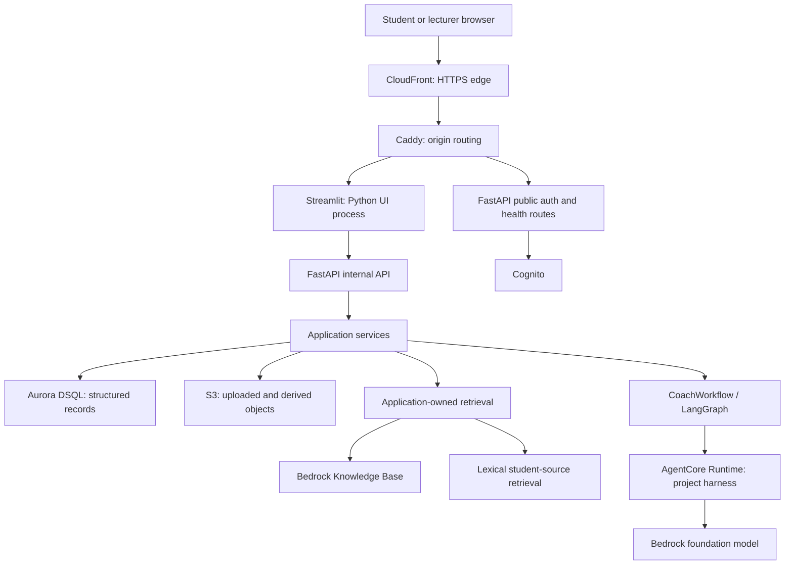
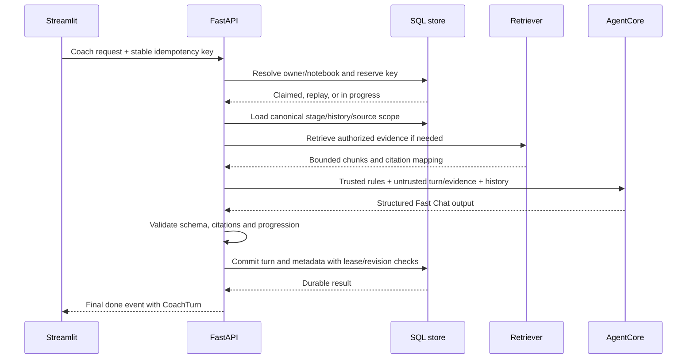
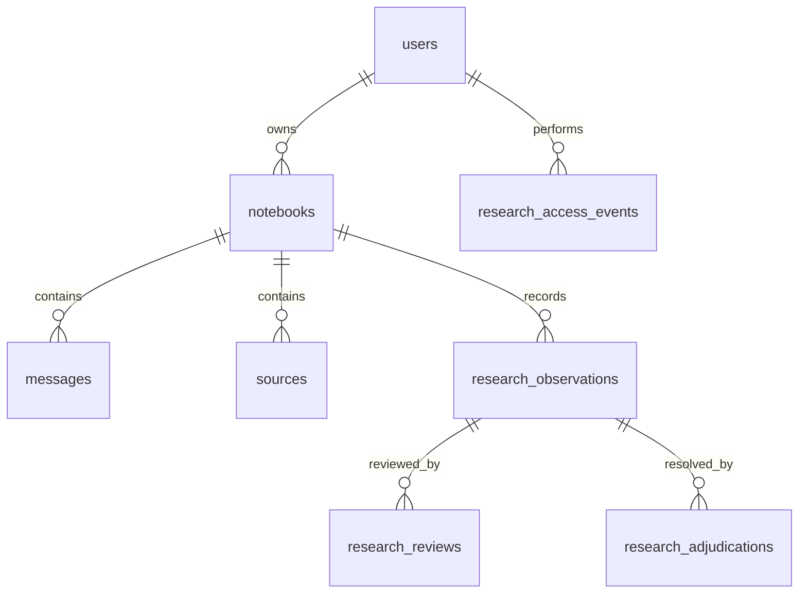
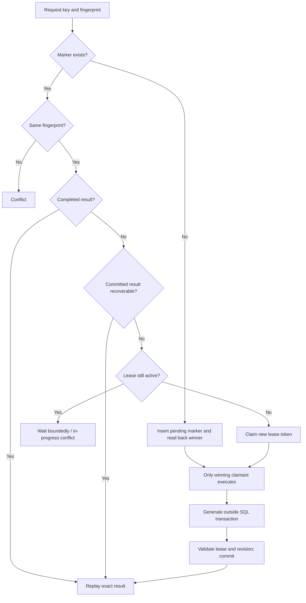
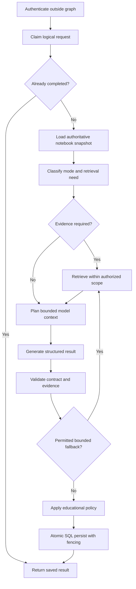

# Co-design Chatbot: a learning handbook

This handbook explains the project from the student's screen to the model and database, then explores how to redesign it. It is written for learning, code walkthroughs, and interview preparation.

**Evidence baseline:** repository `Bedrock-v3`, commit `85f79cc`, inspected 7 September 2026. This is a source-code explanation, not verification of what AWS is currently serving. Infrastructure settings supplied outside the repository, current AWS quotas, actual model charges, and the live image/runtime version have not been inspected.

This is a teaching companion to the existing architecture and operations documents, not a replacement specification. Sections explicitly distinguish implemented behavior, historical behavior, and proposed changes. Where an older document disagrees with executable code, the discrepancy is called out rather than silently copied.

## Reading order

| Chapter | What you will learn |
|---|---|
| [1. System and services](#1-system-and-services) | What the product does; each AWS service, framework, and application service; deployment boundaries; why this design fits a pilot |
| [2. Frontend, API, and a complete turn](#2-frontend-api-and-a-complete-turn) | Streamlit rendering, authentication, request validation, streaming, source upload, revisions, lecturer access |
| [3. Retrieval and model context](#3-retrieval-and-model-context) | Actual RAG paths, lexical versus semantic versus hybrid, chunks, catalog scope, citations, budgets, CRAG and Self-RAG |
| [4. Database and idempotency](#4-database-queries-schema-creation-and-idempotency) | All ten tables, SQL, indexes, DDL, OCC, transactions, retries, leases, failure windows and restart recovery |
| [5. AgentCore and educational workflow](#5-bedrock-agentcore-the-harness-and-the-educational-workflow) | Bedrock versus Runtime versus harness versus Strands; Fast Chat, Deep Review, prompts, schemas, stages and research feedback |
| [6. Running without AWS and extending LangGraph](#6-running-without-aws-and-extending-langgraph) | What already works locally; replacement services; graph design; persistence and migration steps |
| [7. Scaling, operations, and design decisions](#7-scaling-operations-and-architectural-tradeoffs) | Current limits, bottlenecks, capacity math, distributed coordination, queues, observability, cost and security |
| [8. Interview preparation and learning exercises](#8-interview-preparation-and-a-practical-study-plan) | Short and detailed explanations, likely questions, honest contribution narratives, debugging exercises and glossary |
| [Generate the code-derived reference](#generate-the-code-derived-reference) | Route inventory, full table definitions and indexes, module index, and dependency pins |

Start with chapters 1–2 to understand the whole product. Read 3–5 while following the linked Python modules. Read 6–8 after you can explain a single request without using the phrase “the AI handles it.” The reference is for lookup, not sequential reading.

## Five corrections that prevent misleading explanations

1. **The database has ten tables.** The older five-table description covers only the original application core. Research and workflow metadata add five more tables.
2. **The application already contains LangGraph.** Its current graph uses an in-memory checkpointer; durable application recovery comes from SQL. Those are different kinds of persistence.
3. **Normal chat does not run a committee of autonomous agents.** The active AgentCore path uses `fast_chat`; several older role modules remain for compatibility.
4. **RAG has multiple meanings here.** Student uploads use local BM25-style lexical ranking. Official course material uses Bedrock Knowledge Base Retrieve. Combining these is composite retrieval; the application does not implement dense-plus-sparse rank fusion itself. Managed KB internals must be distinguished from application code.
5. **Course Library visibility is not personal source selection.** Locked Lecture Notes and Readings are view-only. Course Q&A can bring in the official catalog through a server-owned intent gate; personal uploads use selection, and attachments can be scoped to the current turn.

## How to read an evidence claim

- **Implemented:** a code path or committed configuration supports the statement.
- **Recorded:** an implementation-status entry describes past testing or deployment; it is dated evidence, not a fresh result.
- **Reasoned tradeoff:** an explanation of why the design makes engineering sense. It is not proof of the original author's personal motivation.
- **Proposal:** an alternative that would require implementation and verification.

No production changes, live model calls, student-data queries, or database migrations were made to prepare this handbook. Existing application test results are identified as historical. Documentation validation checks links, syntax/inventory extraction, and agreement with inspected code; it does not certify the running service.

## Generate the code-derived reference

Generate the appendix from the current checkout without importing application settings or accessing a database:

```sh
.venv/bin/python docs/learning/build_reference.py
```

This command writes only `docs/learning/REFERENCE.md`. It parses source text and SQL string literals; it does not execute the application. Open the generated file to browse the current inventory. Git ignores this output.


## 1. System and services


### 1.1 What are we actually building?

The product is a student research notebook with a critical-thinking coach. A student discusses a design problem, attaches evidence, works through a Thinking Path, and receives formative feedback. A lecturer can inspect learning activity and review research observations. The central problem is not simply generating fluent text: the application must preserve who said what, which evidence was available, which phase the student was working on, and whether an action was applied once.

For example, a student investigating unsafe pedestrian crossings might upload interview notes, ask how those notes support an idea, revise an earlier argument, move into Design specification, and later generate a Deep Analysis PDF. These operations must share one coherent notebook history. A refreshed browser should not lose the notebook; a retried request should not produce two student/assistant pairs; revising an earlier claim should not leave future conclusions active as if nothing changed.

The five current phases are Problem identification, Concept generation, Design specification, Ethics & Critical Thinking, and Reflection. The persisted identifier `deep_analysis` names the ethics phase; it is not the same thing as the separate Deep Review operation. Names in older six-stage documents are historical.

### 1.2 The whole system at a glance



The diagram combines network processes and in-process modules. `Application services`, `RAG`, and `CoachWorkflow` are Python components inside FastAPI, not separate servers. Cognito, DSQL, S3, Knowledge Bases, and AgentCore are external services. The application container runs two processes: Streamlit and Uvicorn/FastAPI.

The production topology is defined in [Compose](../../compose.prod.yaml), [Caddyfile](../../Caddyfile), [Dockerfile](../../Dockerfile), and [production startup](../../scripts/start_prod.sh). The documented origin machine is T4g.small EC2 using an ARM64 image. The repository describes that choice; it does not prove which instance is running today.

### 1.3 What each infrastructure service does

| Service | Plain-language role | What this project puts in it | What it does not own |
|---|---|---|---|
| EC2 | A virtual machine that runs the application processes | Docker, Caddy, the app image, private deployment configuration | Canonical student file bytes or transcript storage |
| ECR | A registry for built container images | Versioned application image tagged with a Git SHA | Running Python processes or student notebooks |
| Docker / Compose | Package the software and start related containers | Python dependencies, source, startup scripts, network configuration | A substitute for backups or distributed coordination |
| CloudFront | Public HTTPS entry point and forwarding layer | Distribution/routing configuration | Educational decisions; the app path deliberately disables caching |
| Caddy | Reverse proxy at the EC2 origin | Public auth/health allowlist and routing to Streamlit | Public exposure of every FastAPI route |
| Cognito | Authentication provider | Login identities and token/session authority | Notebook content, course research scores, or application role decisions by itself |
| Aurora DSQL | SQL database for structured application state | Users, notebooks, messages, source metadata, research records, workflow marker | The PDF/image bytes stored in S3 |
| S3 | Object storage: bytes addressed by keys | Raw uploads, extracted text, chunk artifacts, shared course files | The active conversation branch or user authorization policy |
| Bedrock Knowledge Base | Managed retrieval over official course material | An ingested/searchable representation of course content | Personal notebook ownership or automatic permission to cite a returned hit |
| AgentCore Runtime | Hosts and invokes the generation program | The project's published Python harness and prompt assets | Durable chat history or the student-facing UI |
| Bedrock models | Perform language generation and structured assessment | Model invocations with bounded context | Permission to mutate notebook stage or database rows |
| Bedrock Guardrails | Apply configured content controls around generation | Guardrail identifier/version and model-side enforcement configuration | SQL ownership checks or citation authorization |
| IAM | Grants AWS workloads permissions to AWS resources | EC2/runtime role policies and database connection authority | A replacement for notebook-level access checks |
| Logs / CloudWatch integration | Operational evidence | Category, timing, request and model provenance fields | A second transcript store; full private source content should not be logged |

The checked Compose file uses the Docker `json-file` logging driver with rotation. CloudWatch forwarding is an operations integration described by the release documentation; it is not demonstrated merely by finding a logger in Python.

### 1.4 What the frameworks do

**Streamlit** turns Python rendering code into a browser UI. Widget interactions trigger reruns, so the developer must manage session state and rendering boundaries. It makes a research prototype quick to build but requires care for sophisticated chat scrolling and mobile layouts.

**FastAPI** is the HTTP boundary. It accepts requests, resolves identity, validates shapes, calls services, and returns responses. The route handler should not become the place where all educational reasoning lives.

**Uvicorn** is the server that executes the FastAPI ASGI application. FastAPI describes the application; Uvicorn listens on a port and drives it. One worker is configured in the current startup script.

**Pydantic** validates data shapes at boundaries. A string that “looks like JSON” is insufficient: fields, enums, identifiers, and contracts must be accepted by the models. This catches invalid stage identifiers and malformed assessments before they can become durable state.

**LangGraph** supplies the graph execution abstraction in `backend/workflow.py`. It is a library in the application process, not a replacement cloud provider. The current graph has four nodes, explained in chapter 6.

**Strands** supplies the agent/model invocation loop inside the AgentCore harness. The project constrains that loop with schemas, bounded attempts, and no external specialist tools. Calling a Strands object an “Agent” does not mean the whole product is an autonomous multi-agent system.

**psycopg** connects Python to the PostgreSQL-compatible DSQL interface. **boto3/botocore** call AWS APIs. The local database path uses Python's SQLite facilities. These are infrastructure adapters, not domain rules.

Repository package pins are listed in the [generated reference appendix](#generate-the-code-derived-reference). The FastAPI image and AgentCore runtime have separate dependency manifests and must be validated separately.

### 1.5 Application service ownership

| Component and entry point | Inputs and outputs | Important responsibility |
|---|---|---|
| [HTTP app factory](../../backend/http/app.py) | HTTP requests → typed responses | Compose dependencies, route ownership, request IDs, error mapping |
| [Auth routes](../../backend/auth_routes.py) and [OIDC client](../../backend/auth_oidc.py) | Login callbacks/cookies → verified identity | State/PKCE, token verification, refresh, logout |
| [WorkspaceService](../../backend/workspace_service.py) | Notebook/source operations → projections | Application-level CRUD and transcript access |
| [CoachApplicationService](../../backend/coaching/execution.py) | Coach request → persisted CoachTurn | Canonical context, reservations, retrieval, provider work, atomic persistence |
| [CoachWorkflow](../../backend/workflow.py) | Authoritative request → assessment/recommendation | Provider-neutral educational workflow and progression normalization |
| [Learning service](../../backend/learning_service.py) | Transition decisions → updated learning state | Explicit state transitions, confirmation compatibility |
| [Source library](../../backend/sources/library.py) | Files/text/URLs/catalog → source records | Import, extraction orchestration, shared catalog projection |
| [Context retriever](../../backend/retrieval.py) | Authorized query/sources → chunks | Composite course/student retrieval and context bounds |
| [StudentStore](../../backend/student_store.py) | Repository operations → SQL rows | Ownership, transactions, revisions, idempotency and research persistence |
| [Storage factory](../../backend/persistence/factory.py) | Settings → storage implementations | Select local/DSQL and local/S3 adapters |
| [Professor analytics](../../backend/professor_analytics/service.py) | Staff-authorized scope → dashboard evidence | Aggregation and lecturer notebook projections |
| [Research package](../../backend/research/__init__.py) | Provisional codes/human reviews → attributable records | Research data contracts and persistence adapter |
| [Context planner](../../backend/context_planner.py) | History/evidence → bounded model context | Keep input within budgets without deleting stored history |
| [Rate limiter](../../backend/rate_limit.py) | Active requests → admission or busy response | Bound local concurrency and per-user request rate |
| [Turn performance](../../backend/turn_perf.py) | Execution milestones → diagnostic events | Explain latency without logging student text |

Compatibility files such as `backend/api.py`, `backend/application.py`, `backend/source_library.py`, and `ui/chat.py` preserve old imports. Follow them to their owning packages before modifying behavior. Their existence does not mean a second implementation is active.

### 1.6 Why layers matter: a simple example

Suppose you replace S3 with a local object store. The Sources panel should still ask for “download this source,” rather than learning bucket names and object-key rules. `FileStorage.get_bytes(key)` is the narrow interface; the adapter decides where those bytes live. Similarly, changing the model should not require rewriting the notebook table.

This is dependency inversion: application code depends on an operation it needs, not on a vendor-specific SDK response. Dependency injection means supplying the concrete implementation when assembling the app. Tests supply deterministic fakes; production supplies AWS adapters.

The separation is useful but incomplete. `StudentStore` still owns many responsibilities, and DSQL reuses substantial store behavior through a compatibility proxy. The application is not a perfectly isolated textbook hexagonal architecture. A credible explanation acknowledges both the existing seams and the remaining coupling.

### 1.7 Why this deployment is reasonable, and its cost

The documented single-machine topology is a reasonable pilot tradeoff: one container image, one public origin, a Python UI, and a backend that can spend much of its time waiting for remote inference. A small ARM machine can host that coordination workload without hosting model weights. These are reasoned advantages, not a claim that the project measured every alternative or proved that instance size sufficient.

The cost is availability and scaling flexibility. One origin machine is a failure point. Streamlit session state and WebSocket connections live in its process. FastAPI's counters and review executors also have process-local state. Moving the durable transcript into DSQL does not automatically make every part of the application stateless.

A useful interview sentence is: “The deployment separates durable learning data from replaceable application containers, while intentionally retaining a single-origin execution model for the pilot.” Chapter 7 explains what must change before adding replicas.

### 1.8 Three identities of a release

The Git commit is the source version. The EC2 image is the packaged FastAPI/Streamlit version. The AgentCore published version is the running generation program. They can differ.

For example, updating `ui/professor.py` requires an application image release. Updating `agentcore_runtime/prompts/fast_chat.md` requires publishing runtime assets. Setting a new DEFAULT runtime version also requires checking session-generation behavior so warm compute does not serve old assets. Merely pushing a commit does not complete either deployment.

The current Compose file hard-codes `AGENTCORE_SESSION_GENERATION: "8"`. A host `.env` value with the same name will not override that explicit Compose `environment` entry. The release checklist's instruction to bump the host variable therefore needs a matching Compose change or override, followed by inspection of the effective configuration. This is an observed configuration/documentation mismatch, not a deployment performed for this guide.


## 2. Frontend, API, and a complete turn


### 2.1 Frontend does not mean “everything runs in the browser”

Streamlit rendering code executes in Python on the server. The browser displays the resulting controls and communicates with Streamlit. In production, the Streamlit process calls FastAPI at `http://127.0.0.1:8000`; the browser does not directly call the private coach endpoint through CloudFront.

This distinction explains why Caddy blocks most `/api/*` routes while chat still works. Caddy exposes browser authentication routes and health. The rest of the application API remains accessible to the Streamlit server inside the container.

The frontend entry point is [streamlit_app.py](../../streamlit_app.py). Its meaningful order is authentication, identity binding, staff/student branching, session preparation, theme, and workspace rendering. Staff branch into the lecturer dashboard before student notebook initialization, avoiding accidental student workspace creation during lecturer reads.

### 2.2 UI module map and state

| Module | What the user sees | State to watch |
|---|---|---|
| [workspace.py](../../ui/workspace.py) | Desktop columns and mobile workspace | Which pane is visible, layout mode |
| [panels/nav.py](../../ui/panels/nav.py) | New chat, Search, Library, Recents | Notebook selection, rename/delete dialog state |
| [panels/chat.py](../../ui/panels/chat.py) | Transcript, composer, attachments, edit | Pending draft, request key, streaming status, pagination |
| [panels/sources.py](../../ui/panels/sources.py) | Personal sources and course library | Selection, upload/view dialogs, source refresh |
| [panels/studio.py](../../ui/panels/studio.py) | Thinking Path/Progression and Review | Current stage, Ready state, checkpoint read status |
| [professor.py](../../ui/professor.py) | Roster, activity, notebook workbench, research review | Staff page/tab, selected student and notebook |
| [services/runtime.py](../../ui/services/runtime.py) | No direct visual surface | Owner-scoped facade, API client, rerun helpers |
| [theme.py](../../ui/theme.py) and [styles](../../ui/assets/styles) | Light/Dark/System appearance | CSS cascade and saved preference |
| [layout](../../ui/layout) | Scroll position, composer size, column resizing | Browser DOM observers and event handlers |

There are at least three types of state. Database state is authoritative for messages, source metadata, learning progress, and persisted preferences. `st.session_state` holds current UI interaction state. Browser DOM state holds scroll position, focus, and dimensions. Confusing these causes bugs: changing the visible stage label is not the same thing as saving a stage transition.

The runtime facade directs UI requests to the typed [API client](../../backend/api_client.py). An in-process application-service path remains for local compatibility, but production requires the API path. A panel should not query SQLite or call a model SDK directly.

### 2.3 Why Streamlit reruns were difficult

A normal Streamlit interaction can rerun a Python script. Rerendering an entire chat interface during an in-flight response can reset scrolling, duplicate an apparent workspace, recreate dialogs, or disrupt the composer. The project uses fragments for local updates and full reruns after authoritative application state changes.

For example, changing a small panel control can rerun only that fragment. Completing a persisted chat turn should rerun the app so the durable transcript owns the final bubbles. Changing appearance needs a full rerun because global theme injection happens there. A source poller must avoid triggering a full remount while a turn streams.

Widget keys act like stable identities for controls. Changing them casually can detach stored widget state from the intended control. Browser-side layout helpers exist because Streamlit does not expose all the required scrolling and sizing behavior directly. They are a practical adaptation with a maintenance cost: framework DOM changes can invalidate assumptions.

Recent history is paginated from the newest messages; the implementation-status history records six-message opening windows and upward pagination. The full transcript remains stored. “Only six messages on screen” and “only six recent messages in a model input window” are separate optimizations.

### 2.4 Authentication, step by step

1. The browser opens the public login endpoint.
2. FastAPI creates an expiring OAuth state and PKCE verifier, persisted in `oauth_login_states`.
3. The browser goes to Cognito's login page.
4. Cognito redirects to the configured callback with an authorization code and state.
5. FastAPI validates the callback state and exchanges/verifies credentials through its OIDC adapter.
6. Secure, HttpOnly cookies carry the refresh and ID tokens. The refresh cookie is scoped to `/api/v1/auth`; the ID cookie is available at `/` so Streamlit can forward it for verification.
7. `/auth/me` returns a safe user projection. The verified Cognito subject maps to the application owner, generally `cognito:<sub>`.
8. Expired ID-token handling redirects the browser through refresh. Logout clears cookies and invokes the configured revocation behavior.

PKCE binds the authorization-code exchange to the initiating login flow. OAuth state protects the callback flow from substitution. HttpOnly makes a cookie unavailable to ordinary browser JavaScript; Secure restricts browser transmission to HTTPS. None of these replaces notebook authorization.

The application still checks that a notebook belongs to the verified owner. A lecturer view independently requires a persisted lecturer/admin role. Hiding a button in the UI is a usability decision, not an access-control mechanism. See [auth routes](../../backend/auth_routes.py), [OIDC](../../backend/auth_oidc.py), and [HTTP app](../../backend/http/app.py).

### 2.5 What happens when Send is clicked?

Consider: “According to my uploaded interview notes, what assumption am I making about older pedestrians?”



The exact ownership of work is:

- The route handles HTTP and identity. Header and body idempotency keys must agree if both are supplied.
- The application reloads the canonical notebook revision, history, active stage, and source scope. Client-supplied history or stage cannot overwrite them.
- A keyed request reserves a durable marker before expensive provider execution. Completed retries can replay.
- A local limiter admits the workflow or returns a busy result.
- Mode policy and retrieval determine which evidence enters the request. No model gets unrestricted access to all student uploads.
- Context planning bounds recent history and evidence. The workflow invokes a provider and constructs an educational turn.
- The application validates citations and applies server-owned progression rules. A retrieval fallback may require one bounded second outer invocation.
- SQL persistence checks the stage/revision and lease before committing the final pair and associated metadata.

These are conceptual milestones; follow `_submit_body`, `_submit_once`, `_prepare_authoritative_turn`, and `persist_coach_turn` for the precise code ordering and special cases.

### 2.6 What is the API contract?

An API contract says what callers may send and what responses mean. `CoachRequest`, `CoachTurn`, assessments, source projections, and review-job models provide typed contracts. Optional model-generated fields are not automatically trusted because they passed JSON parsing.

An illustrative normal request is:

```json
{
  "thread_id": "notebook-example",
  "student_message": "What assumption is present in my reasoning?",
  "current_stage": "problem_identification",
  "response_detail": "short",
  "idempotency_key": "one-logical-send-unique-key"
}
```

This is an example, not a credentialed command. Omit source/history fields unless the client contract calls for them; the server resolves them. A caller that supplies a mismatched active stage is rejected rather than moving the notebook.

| API family | Representative operation | Meaning |
|---|---|---|
| Auth | `GET /api/v1/auth/me` | Validate session and project user identity |
| Readiness | `GET /api/v1/ready` | Internal dependency/configuration readiness |
| Notebooks | `GET/POST /api/v1/threads` | List or create owned notebooks |
| History | `GET /api/v1/threads/{thread_id}/messages` | Active conversation projection |
| Revision | `POST /api/v1/threads/{thread_id}/messages/{message_id}/revise` | Append a replacement branch and regenerate |
| Sources | `POST /api/v1/threads/{thread_id}/sources` | Ingest personal source files |
| Attachments | `POST /api/v1/threads/{thread_id}/attachments` | Add sources intended for attachment behavior |
| Coach | `POST /api/v1/coach/turn` | Synchronous completed turn |
| Coach stream | `POST /api/v1/coach/turn/stream` | Progress events followed by completed turn |
| Stage selection | `POST /api/v1/threads/{thread_id}/learning-state/select-stage` | Feature-gated, server-validated movement |
| Review | `POST/GET /api/v1/threads/{thread_id}/deep-review` | Enqueue or inspect explicit review job |
| Lecturer | `/api/v1/professor/...` | Protected aggregates, notebook evidence, research review |

The [generated reference](#generate-the-code-derived-reference) lists all literal route registrations, handlers, declared responses, and dependency defaults. Some routes exist conditionally. The list is not a claim that all routes are reachable on the public hostname.

### 2.7 Streaming: what actually travels?

The route returns `application/x-ndjson`: newline-delimited JSON. Each line is an independent event, so a receiver can parse progress before the response finishes.

```json
{"event":"started","stage":"problem_identification"}
{"event":"status","phase":"example-phase","label":"Example progress label"}
{"event":"done","turn":{"response_text":"...","assessment":{}}}
```

Two further events exist for clients that opt in (header `X-Coach-Reply-Deltas: 1`, with `COACH_STREAM_REPLY_DELTAS_ENABLED` on, default off): `{"event":"reply_delta","text":"..."}` carries an unvalidated, ephemeral fragment of the reply being generated, and `{"event":"reply_discard"}` withdraws every fragment so far. `reply_ready` remains the validated reply and `done` the only saved acknowledgement. Only the mock and direct Bedrock Converse providers produce fragments; the AgentCore Runtime path returns one JSON object and sends none.

The last example abbreviates the required assessment fields; it is not a valid standalone `CoachTurn` fixture. Actual code also emits a small `graph` summary and structured `error` events. The `example-phase` value is illustrative, not a real progress enum.

The current route runs a background thread and consumes progress from a queue. It does not stream raw model tokens into the response in this path. The final answer arrives after structured validation and persistence. This supports trustworthy saved output and visible progress, but it is different from token-by-token LLM streaming.

Once a streaming HTTP response has started, a later failure cannot simply change the original status line. The stream sends an error event with a status/category such as 409, 429, or 503. Clients must inspect event content, not interpret HTTP 200 as proof that generation succeeded.

Browser cancellation and backend cancellation are also different. If the browser stops waiting while the backend commits successfully, the durable result may still exist. The recovery action is to reload/replay with the same logical request key. Do not promise that a Stop click always cancels an already-running external model call or its charges.

### 2.8 Uploads and source management

An upload is validated and stored under generated source keys. Extracted text and chunk artifacts are derived separately from raw bytes. Text/PDF/Office handling lives in [file_processing.py](../../backend/file_processing.py): PDF extraction uses `pypdf`; Word paragraphs use `python-docx`; PowerPoint text uses `python-pptx`; spreadsheets are read with `openpyxl`. The code bounds large PDFs and Office archives. A PDF that contains scanned pictures only may not yield readable text; extraction is not proof that OCR ran.

The configured defaults include five files per message and a 10 MB file-size limit, with separate course-material bounds. Environment values and the particular ingestion path matter, so these are not universal permanent upload allowances.

URL ingestion validates public URLs and redirects to reduce server-side request forgery risk. Source content must remain untrusted even when it comes from a course PDF: a document can contain “ignore previous instructions,” but that text is evidence, not an application command.

Personal selection persists as source metadata. Course Library entries are locked/view-only; adding them to the screen does not make them checked personal sources. The backend may retrieve the official catalog for a course question independently. Chapter 3 explains the resulting scope.

### 2.9 Editing a message is a new branch

If a student changes “older users prefer speed” to “older users prefer longer crossing times,” later answers based on the original claim should not remain active. The edit endpoint creates a new conversation revision, marks later rows superseded for the active projection, and preserves historical rows and lineage.

The UI retains a stable edit idempotency key for retries. If regeneration fails, it restores the draft and requires an explicit resend rather than silently retrying on every rerun. The backend must reject an old worker that tries to commit against a superseded revision. This is why “just replace the bubble text” would be an incomplete edit implementation.

### 2.10 Lecturer and research access

The lecturer workbench reads a student's notebook in several projections: transcript, sources, journey, and review. Fetching tabs lazily avoids loading every long transcript and source on initial roster opening. The current review projection merges checkpoint evidence with existing review state while preserving a meaningful coaching summary when present.

Identifiable research reads and exports write attributable access audits before returning data; audit failure causes the protected read to fail. Human reviews and adjudications append records rather than rewriting the original automated observation. CSV export includes formula-safety handling because a spreadsheet can interpret values beginning with formula syntax as executable formulas.

The access audit records who inspected data; it does not grant permission. The role and scope checks must succeed first. These details make the project closer to a research application than a disposable chat demo.


## 3. Retrieval and model context


### 3.1 RAG in everyday language

Retrieval-augmented generation means looking up relevant evidence and putting it into the model's input before asking for an answer. The model has general knowledge from training, but a student's interview notes and the exact lecture material need to be supplied. Retrieval chooses a manageable subset rather than sending every document on every turn.

Imagine a tutor with a bookshelf. Retrieval is finding the right paragraphs. Generation is explaining those paragraphs in response to the student's question. Citation handling is recording which book and passage were actually used. Authorization decides which bookshelf the tutor may open. These are separate responsibilities.

RAG does not guarantee a correct answer. The wrong passage can be retrieved; extraction can miss a table; a right passage can be misinterpreted; a citation can point to a real document without supporting the particular claim. Each stage needs its own evaluation.

### 3.2 The actual retrieval architecture

The key source files are [retrieval.py](../../backend/retrieval.py), [bedrock_retrieve.py](../../backend/bedrock_retrieve.py), [retrieval_gate.py](../../backend/retrieval_gate.py), [mode policy](../../backend/coaching/mode_policy.py), and [turn preparation](../../backend/coaching/execution.py).

| Material | Storage | How it becomes eligible | Retrieval implementation |
|---|---|---|---|
| Personal My Sources | Local files in development, S3 in production; metadata in SQL | Selected for the owned notebook | `LocalChunkRetriever`: deterministic lexical ranking of extracted chunks |
| Current-turn attachment | Stored source plus turn attachment association | Included/scoped by the current request and server policy | Text chunks or image input; attachment-only scope can exclude unrelated material |
| Official course material | Shared `course/` objects and a virtual catalog | Course intent causes server-owned catalog inclusion | `BedrockKnowledgeBaseRetriever` via Retrieve |
| Ordinary project discussion | Durable transcript plus derived memory | Current notebook conversation | Retrieval may be skipped; bounded history supplies continuity |

`CompositeContextRetriever` splits course sources from student sources, calls the appropriate adapters, and formats compatible chunks. It currently processes the KB branch and local branch sequentially in its implementation. It does not perform application-owned reciprocal-rank fusion of dense and sparse candidates.

Older RAG docs repeatedly say “selected course sources.” At the adapter boundary that still describes the request's authorized source scope. At the current UI boundary, locked course entries are not user-selected checkboxes. `TurnSnapshot` excludes locked course rows from personal selection; `_hydrate_retrieval_sources(..., include_course_catalog=True)` supplies the course catalog when policy requires it. This distinction is essential when explaining the current product.

### 3.3 Lexical, semantic, hybrid, and composite are different

**Lexical retrieval** matches words or phrases. A query containing “pedestrian crossing” strongly matches a chunk containing those words. It is useful for exact terminology, identifiers, and reproducible local tests. It can miss synonyms: “older adults” and “elderly pedestrians” may be semantically related while sharing few terms.

**Semantic retrieval** uses meaning-oriented representations or a managed semantic retrieval system. A common implementation embeds text into vectors and searches for similar vectors. Embeddings represent text as lists of numbers, not stored prose. Vector similarity is a relevance signal, not truth.

**Hybrid search**, in its usual retrieval sense, combines lexical and semantic signals for the same search corpus. The application here does not implement a local vector index plus BM25 fusion. It delegates course retrieval to a managed KB and uses lexical retrieval for personal uploads.

**Composite retrieval** means combining retrieval backends or source groups. That is the directly evidenced application design here. **Hybrid model selection** can also mean using a smaller model for chat and a stronger model for review; that has nothing to do with hybrid search.

AWS describes its managed KB Retrieve connector as hybrid search. That is useful service-level context, but this repository's adapter does not reveal the live embedding model, internal ranking, ingestion chunk configuration, or backing index. It also does not install an AgentCore Gateway connector: it calls Retrieve from FastAPI. Say “managed KB retrieval for courses plus lexical retrieval for student uploads,” and qualify any more specific claim about deployed KB internals. [AWS managed KB connector documentation](https://docs.aws.amazon.com/bedrock-agentcore/latest/devguide/gateway-add-target-api-target-config.html)

### 3.4 How personal text becomes chunks

The source importer saves raw bytes, extracts text, and can write `derived/chunks.v1.json`. A valid chunk artifact avoids reconstructing chunks every query; an invalid/missing artifact falls back to chunking extracted text. The chunk cache is an optimization, not the authoritative source of document bytes.

`LocalChunkRetriever` defaults to chunks around 1,800 characters with 220 characters of overlap, and the chunking function tries to respect text boundaries. Character limits are not token limits. Tokens are the model's encoding units; the same number of characters can produce different token counts across languages and content.

Overlap preserves context around a boundary. Without overlap, a paragraph ending “the following assumption was rejected” might be separated from the next sentence explaining the assumption. Too much overlap repeats evidence and wastes context space. Too-small chunks lose meaning; too-large chunks dilute relevance and consume model budget.

The extractor has practical coverage limits. Word paragraph extraction does not imply every table/header is represented. Spreadsheet cached formula values are not a recalculation engine. Text extraction from a PDF is not full visual interpretation of its charts. A useful improvement would evaluate tables, scanned PDFs, and slide diagrams explicitly rather than assume a document's text is complete.

### 3.5 The student ranking algorithm, explained

The implementation is **BM25-style**, not a claim of exact standard BM25. Its score combines:

1. Weighted query-term overlap.
2. Higher value for terms appearing in fewer candidate chunks.
3. A frequency saturation/length normalization term.
4. Title boosts.
5. Adjacent-word pair boosts in text and titles.

For a matched term, the inspected code uses:

```text
inverse_frequency = log(1 + (N - df + 0.5) / (df + 0.5))
length_factor = max(0.7, number_of_distinct_terms_in_chunk / 180)
normalized_tf = term_frequency / (term_frequency + 1.2 * length_factor)
term_contribution = query_weight * inverse_frequency * normalized_tf
```

`N` is the candidate count; `df` is the number of candidates containing the term. A rare topic word gets more weight than a word present everywhere. Repeating a word helps only up to a point because frequency is normalized. The implementation uses distinct-term count in its length factor, so calling this textbook BM25 would hide a real difference.

The code adds a 0.8 weighted title-term boost, 1.25 for matching text bigrams, and 2.0 for title bigrams. Stemming, stop-word removal, and session aliases such as lecture/week numbering improve matching. Ties are resolved deterministically by source/chunk order.

Selection favors source diversity: first pick a strong chunk from different relevant sources, then fill remaining capacity with more evidence, subject to per-source limits. The class default is up to eight chunks and two per source; normal Fast Chat applies tighter four-chunk / 8,000-character budgets. Distinguish constructor defaults from the configured caller's effective limits.

If no chunk has positive lexical score, the local adapter has a representative-beginnings fallback. This helps “summarize these sources,” but it can also deliver weak evidence. Therefore “retriever returned something” must not be equated with “retriever found strong support.” Evaluation should include unrelated questions and generic summaries.

### 3.6 Course Knowledge Base retrieval

Official course objects live under the shared course namespace. The application does not duplicate a PDF for every notebook. Catalog rows can be virtual and intentionally contain no extracted text. A missing KB must yield an evidence gap for those objects, not a fabricated chunk based on display placeholder text.

The adapter calls **Retrieve**, which returns evidence. It does not call **RetrieveAndGenerate**, which would also ask the service to generate an answer. Keeping generation separate allows FastAPI to retain citation mapping, context limits, and the educational output contract. AWS documents Retrieve as a standalone retrieval operation. [AWS Retrieve documentation](https://docs.aws.amazon.com/bedrock/latest/userguide/kb-test-retrieve.html)

The checked production config declares `KNOWLEDGE_BASE_TYPE=MANAGED`. The adapter selects `managedSearchConfiguration` for that type, and `vectorSearchConfiguration` for a VECTOR KB. Do not infer that a VECTOR payload is appropriate merely because RAG often uses vectors.

The metadata identifier `course_material_id` is derived from object keys, including nested path components to avoid filename collisions. Sibling `.metadata.json` files accompany course objects for ingestion. The request can filter by one ID using `equals` or several IDs using `in`.

Three explicit filter modes exist:

| Mode | Behavior | Tradeoff |
|---|---|---|
| `required` | Send the metadata filter; retrieval failure becomes an evidence gap | Strong intended retrieval scope; needs properly ingested metadata |
| `degraded_unfiltered` | Retrieve without that filter, then validate bucket and object key | Temporary recall/efficiency compromise; unauthorized hits are still rejected |
| `disabled` | Do not retrieve | Course grounding unavailable |

There is no hidden automatic unfiltered retry after a required-filter error. That would silently change scope and mask operational problems.

Every surviving KB hit is checked against the expected course bucket and authorized object key. A metadata filter improves precision; it is not the authorization boundary. An old export path and the new `course/` path are different objects even if their filenames match. The application must not “repair” mismatches by guessing.

### 3.7 Why there is a retrieval gate

“I think my target user feels rushed” can be coached without searching every course file. “According to Week 2, what is a job story?” needs course evidence. Retrieving for every selected-source notebook adds latency and can turn an ordinary coaching prompt into an unnecessary evidence-gap answer.

The gate is deterministic Python matching, not an extra LLM router. It recognizes course/source names, citations, definitions, and narrow summary requests, while treating personal reasoning and generic help conservatively. It also accounts for titles, attachments, and workflow navigation through the broader mode policy.

A deterministic gate is cheap, inspectable, and testable. Its weakness is language coverage: unusual phrasing, multilingual queries, and ambiguous references can be missed. Those cases should become evaluation examples rather than an ever-growing unmeasured list of regexes.

If the first Fast Chat response says `needs_source_retrieval=true` after retrieval was skipped, the application can retrieve and invoke again within its outer-call budget. The provisional first result is not persisted as the final turn. Runtime agents still do not search the KB themselves.

This is a bounded corrective fallback. It is not the complete CRAG algorithm. Recovery from a transient structured-output harness error shares the two-outer-invocation budget, so not every recovery path can independently add another call.

### 3.8 Citations and evidence integrity

The internal chunk record includes source ID, request label, title, chunk ID, text, score, origin, and optional location fields. `[S1]` is a convenient label for a source in the request; it is not a globally permanent database identifier. Internal IDs such as `S1-C2` distinguish chunks for auditing.

The application records two related things: `retrieval_refs` describe evidence supplied to the model, while `source_refs` describe validated citations actually used. A supplied source may not be cited. A model-invented source label must not become a working citation merely because it looks syntactically correct.

Citation resolution uses the request's source snapshot and retrieved evidence. It should not fetch a changing catalog again after generation and accidentally map a label onto different content. A snapshot also reduces repeated source reads.

Structural validation answers “is this an allowed, supplied source?” It does not fully answer “does this excerpt logically support every associated claim?” A future groundedness evaluator should measure support at the claim level without weakening the existing authorization checks.

### 3.9 Memory is not RAG, and storage is not context

The entire active transcript can be stored while only part is sent to the model. Fast Chat configuration uses up to six recent verbatim messages, around 3,000 estimated history tokens, and up to 1,500 per historical message, plus derived conversation memory. Total Fast Chat input has a 12,000-token soft target and 16,000-token maximum in Compose.

Conversation memory is a summary/projection, not a replacement transcript. It should be invalidated after a revision because the old summary may contain superseded reasoning. Deep Review uses its own larger planning strategy, including full-history or checkpoint-plus-delta context depending on eligibility and size.

Retrieval finds document evidence; recent history preserves dialogue; derived memory preserves compressed continuity. A prior assistant assertion is not valid course evidence just because it is in memory. An evidence gap should remain visible when course-grounded answering is required.

### 3.10 What CRAG, Self-RAG, and feedback would change

CRAG adds retrieval-quality evaluation and corrective behavior, including alternate retrieval strategies when evidence is poor. Its paper includes a retrieval evaluator and corrective actions; this project does not implement that full method. For this educational app, a bounded evaluator could label evidence sufficient/insufficient and retry within the course corpus. Open-web fallback would require a deliberate new source policy. [CRAG paper](https://arxiv.org/abs/2401.15884)

Self-RAG is a specific method that learns retrieval and reflection behavior using special reflection tokens. A prompt saying “check your answer” is not equivalent to implementing that training/inference method. A simpler proposal here is a small, separately evaluated groundedness check for selected tasks. [Self-RAG paper](https://arxiv.org/abs/2310.11511)

Student learning feedback, lecturer research coding, retrieval evaluation, model self-critique, and model fine-tuning are different feedback loops. Existing research review does not automatically update model weights. To use lecturer judgments for improvement, define an offline labeled evaluation set, record prompt/model versions, compare candidates, and approve a release. Do not allow one noisy judgment to alter the production coach immediately.

### 3.11 How to evaluate and improve this RAG

Create questions with known relevant chunks, including synonyms, exact lecture identifiers, mixed course/personal evidence, attachment references, and questions with no supporting source. Measure retrieval recall@k, precision@k, wrong-source rate, citation support, evidence-gap honesty, latency, and cost per answer. Evaluate the gate separately: how often did it retrieve needlessly, or skip when evidence was required?

A plausible improvement experiment is adding an embedding retriever for personal uploads, preserving notebook filters, then fusing lexical and semantic ranks. Reciprocal rank fusion could combine ranks without assuming the two score scales are comparable. That is a proposal, not current code. Compare it against the existing lexical baseline before accepting extra embedding storage, ingestion latency, and deletion complexity.

Other focused improvements include table-aware extraction, OCR for scanned PDFs, a small reranker, multilingual gate tests, explicit evidence-coverage warnings, and caching shared catalog metadata. Each should have a measured failure case. “Use a vector database” by itself does not explain which current problem it solves.


## 4. Database, queries, schema creation, and idempotency


### 4.1 Two database implementations, one application model

Locally the project uses **SQLite**, an embedded SQL database stored in a file. Production uses **Aurora DSQL**, accessed through psycopg and an adaptation layer. These are relational databases: records have columns, identifiers, and relationships. The code does not use DynamoDB as its transcript store.

Structured data stays in SQL; large file bytes stay in object storage. A source row stores an object key such as `users/<owner>/notebooks/<notebook>/sources/<source>/raw/notes.pdf`. That key locates an S3 object in production or a corresponding file through the local adapter. SQL does not need a binary copy of the PDF to manage selection and ownership.

The current schema has **ten tables**, not five. The exact definitions and indexes are included in the [generated reference](#generate-the-code-derived-reference), extracted from [SQLite schema](../../backend/persistence/store/sqlite_schema.py) and [DSQL schema](../../backend/persistence/dsql_schema.py).

### 4.2 Every table and why it exists

| Table | Important columns | Purpose and example |
|---|---|---|
| `users` | `id`, `identifier`, `cognito_sub`, `role`, `preferences_text` | Application owner/profile, e.g. a Cognito subject mapped to a student or lecturer |
| `oauth_login_states` | `state`, `code_verifier`, `created_at`, `expires_at` | Short-lived login transaction state; not an application session table |
| `notebooks` | `id`, `user_id`, `current_stage`, `progress_text`, `settings_text`, `conversation_revision` | Root of a student's project conversation and learning state |
| `messages` | `id`, `notebook_id`, `role`, `content`, `assessment_text`, citation/decision fields, revision columns | User/assistant history, decision evidence, and internal request reservation rows |
| `sources` | `id`, `notebook_id`, `kind`, object keys, `selected`, `metadata_text` | Personal/imported source metadata and storage references |
| `research_observations` | user/assistant message IDs, revision, coding/model/prompt versions, phase, evidence fields | Immutable provisional automated research coding linked to a specific turn |
| `research_reviews` | observation ID, reviewer ID, status, coding fields, notes, superseded review ID | Append-only human review of automated coding |
| `research_adjudications` | observation ID, adjudicator ID, decision, referenced review IDs | Append-only resolution of reviewed interpretations |
| `research_access_events` | actor, action, scope, request ID, optional targets and filters | Attributable access audit for protected research operations |
| `system_metadata` | `key`, `value_text`, `updated_at` | System-level workflow compatibility marker |

Fields ending in `_text` often contain JSON serialized into SQL TEXT. For instance, notebook `settings_text` can contain journey checkpoints and review-job state. Flexible JSON-shaped data made it possible to evolve the workflow without adding a column for every pedagogical field. The tradeoff is harder SQL reporting, weaker database-level validation of inner fields, and larger read/modify/write conflicts.

There is no standalone `phase_transitions` table in this schema. Proposed-stage and decision fields, plus internal metadata, represent transition state. Idempotency markers are internal `messages` rows and are filtered out of visible history and counts. Therefore counting every `messages` row is not the same as counting chat bubbles.

### 4.3 Relationships and ownership



The diagram shows logical relationships. SQLite declares foreign keys and cascades in the schema. The DSQL schema omits those constraints, and application code performs ownership validation and ordered deletion. Do not describe this diagram as proof that DSQL enforces every relationship with a foreign key.

For a message, ownership is derived through `messages.notebook_id → notebooks.user_id → users.id`. A client cannot claim ownership by supplying a user ID. The server binds a store/service to the verified owner and checks the parent notebook.

Research observations also reference the original user and assistant messages; automated evidence can be stored as offsets into the student's message rather than duplicate private transcript text. The unique assistant-message observation relationship helps prevent duplicate automated observations for the same completed turn.

### 4.4 How SQL is queried

The store issues SQL through a connection interface. Here is a simplified ownership check matching the code's query shape:

```sql
SELECT id, settings_text, conversation_revision
FROM notebooks
WHERE id = ? AND user_id = ?;
```

The values are passed separately, for example `(thread_id, owner_id)`. They are not concatenated into the SQL string. Binding values prevents user text from becoming SQL syntax. Dynamic table/column names still require controlled code; value placeholders do not authorize arbitrary identifiers.

The DSQL proxy transforms SQLite-oriented `?` placeholders into psycopg `%s` placeholders, preserves quoted literals, and escapes literal percent signs for psycopg. It adapts `INSERT OR IGNORE` to `ON CONFLICT DO NOTHING`; it rejects `INSERT OR REPLACE` because replacement semantics are not safely portable. See [dsql_connection.py](../../backend/persistence/dsql_connection.py).

An illustrative notebook list query is:

```sql
SELECT id, title, current_stage, updated_at
FROM notebooks
WHERE user_id = ?
ORDER BY updated_at DESC;
```

The index on `(user_id, updated_at)` supports that access pattern. Index column order matters: an index beginning with user ID helps find one user's notebooks and then order their activity. It does not automatically optimize every unrelated report.

Active-history retrieval additionally filters internal marker rows and revision visibility. A conceptual revision predicate is:

```sql
conversation_revision <= :active_revision
AND (superseded_at_revision IS NULL
     OR superseded_at_revision > :active_revision)
```

This is explanatory SQL; the store owns the exact predicate and parameter syntax. Ordering by timestamp plus ID provides a deterministic tie-break when timestamps match. Cursor pagination must bind to a conversation revision so an edit cannot splice pages from two incompatible histories.

### 4.5 Indexes are a workload decision

The schema indexes notebook activity, messages by notebook/time/ID, message decision lookups, source ordering, observation queue status, human review history, and audit requests. DSQL also has unique indexes for identity fields and the assistant-to-observation relation.

An index makes matching reads faster at the cost of storage and extra write work. Before adding one, identify the query and its filter/sort pattern. Before saying a query scales, inspect its query plan in the chosen database with realistic row counts. The presence of DSQL does not make a Python loop over every message cheap.

One visible example is `_recorded_coach_turn`: a recovery path selects assistant rows and inspects their metadata for a request key. This is useful for durability compatibility, but large notebooks could make it expensive. A dedicated request table or queryable request-key column is a reasonable future improvement if measurements justify the migration.

### 4.6 How tables are created

**SQLite:** opening the local `StudentStore` initializes its schema and known compatibility migrations. `scripts/init_db.py` is an explicit helper for a chosen database path. It refuses an existing file unless a force option is deliberately used. Schema creation and resetting existing student learning data are different operations.

**DSQL:** the application runtime does not run CREATE/ALTER/INDEX. The administrator runs [init_dsql.py](../../scripts/init_dsql.py), which delegates to [scripts/dsql/cli.py](../../scripts/dsql/cli.py). The script uses admin connection authority, applies one DDL statement per transaction, handles asynchronous index jobs on a dedicated autocommit connection, inspects existing columns, and applies documented additive updates/backfills.

Runtime uses `co_design_app` with DbConnect and data-operation grants. Administrator bootstrap uses DbConnectAdmin. This reduces the chance that ordinary application startup can change the schema.

`CREATE TABLE IF NOT EXISTS` only handles a missing table; it does not automatically upgrade an existing table's columns. That is why catalog inspection and additive ALTER/backfill logic are needed. Index jobs completing is another gate: issuing CREATE INDEX ASYNC is not the same as observing the index ready.

The workflow marker distinguishes compatible five-phase learning data from incompatible old state. A nonempty database without the expected marker is not silently reinterpreted. The explicit reset process inventories data and preserves accounts/auth, with recovery artifacts for SQLite. Do not use reset to hide a failed readiness check.

### 4.7 Transactions and OCC

A transaction groups related SQL changes so they commit together or roll back together. For a normal successful coach turn, the important unit includes the user row, assistant row, assessment/citations, learning metadata, applicable transition state, optional research observation, and exact keyed result when supplied.

The model call happens outside that SQL transaction. Holding a transaction open while waiting for generation would increase conflicts and make retries unsafe. After the model finishes, the transaction checks that the notebook stage/revision and request lease still match the state used for generation.

DSQL uses optimistic concurrency handling in this adapter. “Optimistic” means work proceeds assuming a conflict will be uncommon; at commit, conflicts can require a retry. `run_dsql_transaction` retries the whole database unit for recognized serialization/OCC failures, including SQLSTATE `40001`, with bounded exponential backoff plus jitter. The inspected default is five attempts.

Jitter adds a small random delay so conflicting clients do not all retry at the same instant. A retry callback must contain only operations safe to repeat. Repeating a SQL transaction after rollback is different from repeating a paid model call, sending an email, or uploading an object. External work stays outside the retry callback.

### 4.8 Idempotency, explained with a lost response

Idempotency means repeating the same logical operation does not multiply its intended effect. Suppose Send succeeds on the server, but Wi-Fi drops before the student sees the result. Retrying should recover the completed turn instead of appending a second pair.

The client therefore assigns one **idempotency key** to one logical send. It reuses that key while retrying that send. A genuinely new message gets a new key. A request ID used for logs is a different identifier and may change on each network attempt.

The application computes a **fingerprint**: a SHA-256 digest of normalized request fields. It excludes the retry key and selected server-derived mode fields, and separates Deep Review's operation surface. The digest lets the server detect “same key but different request.” It is not encryption and is not an authorization token.

A deterministic UUID marker ID incorporates owner, notebook, and key. The marker is stored as an internal message with request fingerprint, status, lease token, lease expiry, and eventually the completed turn. Its primary key makes competing claims converge on one row. [Fingerprint code](../../backend/coaching/execution.py) · [Marker lifecycle](../../backend/student_store.py)

### 4.9 The claim/replay state machine



`INSERT ... ON CONFLICT (id) DO NOTHING` is followed by reading the winner. It is not enough to assume “my insert ran, so I own the request.” The returned lease token identifies which worker actually acquired it.

A **lease** is temporary ownership. It makes a crashed request recoverable after expiry. Before committing, the worker must prove it still owns the lease. If another worker reclaimed it, the stale worker cannot overwrite the result. This check is a fencing mechanism: it prevents an old worker's later write from being accepted.

The lease duration is derived from bounded retrieval and provider timeout budgets, plus margin. A short lease could expire during a legitimate long generation, letting another worker spend money on a duplicate call and rejecting the first worker's eventual write.

### 4.10 What guarantees exist—and where they stop

| Situation | Expected behavior |
|---|---|
| Same key, same completed request | Return saved `CoachTurn`; no second durable pair |
| Same key, different fingerprint | Conflict rather than returning an unrelated old answer |
| Same key while owner is still executing | Bounded wait/in-progress handling |
| Worker crashes before generation completes | Lease eventually expires; a retry can reclaim |
| Worker crashes after SQL commit | Recover the durable result or replay the completed marker |
| Old worker returns after lease was reclaimed | Reject its commit |
| Notebook revision changed during generation | Reject stale generation's commit |
| No idempotency key supplied | The submit path can execute without durable keyed replay |
| Two distinct keys for the same text | They represent two operations; same-key deduplication does not merge them |

The last two rows are important. The normal coach request's key is optional in the current application path. Do not say every POST is idempotent. Creation/upload endpoints need their own semantics, and GET is only read-like at the HTTP level—some professor reads intentionally append audit events.

The strongest accurate claim is **durable deduplication of keyed turn effects**, with revision and lease protection. It is not universal exactly-once model execution. A provider can finish and charge while the application crashes before persistence; retrying can call it again. Preventing duplicate SQL rows and preventing every duplicate external charge are different problems.

Also, the deterministic reservation key is per request, not a universal cross-replica lock for every distinct request in a notebook. The current process-local notebook limiter serializes local requests. Adding replicas requires a deliberate cross-process notebook coordination design for different keys, alongside the existing same-key reservation.

### 4.11 Revisions and stale writes

`notebooks.conversation_revision` marks the active branch. Message rows record `conversation_revision`, `previous_message_id`, and `superseded_at_revision`. Editing creates lineage while retaining old content. The edit operation can persist its new user revision before model regeneration succeeds, so it is not identical to the ordinary all-at-once user/assistant commit.

Compare-and-swap means “update only if the expected version still matches.” For example, a worker generated against revision 3; if an edit moves the notebook to revision 4, its commit must fail. Some notebook metadata updates additionally compare the prior `updated_at` to avoid losing concurrent JSON-field updates even when the revision stays the same.

Revision logic must cover conversation memory, research analytics, completion state, and old idempotency keys. Otherwise an apparently correct transcript could still carry stale derived evidence.

### 4.12 SQL and S3 cannot share one local transaction

Deleting a notebook involves SQL rows and objects. The implementation commits database deletion before object-prefix cleanup, with explicit child deletion ordering for DSQL. If object deletion fails, cleanup is retryable; it should not be falsely counted as completed.

This is a distributed consistency problem. There can be orphan objects after a partial failure. A future transactional outbox would save a cleanup task in the same SQL transaction and let a worker retry until completed. That proposal improves reliable cleanup without pretending SQL rollback can undo an already-sent S3 request.

Likewise, a backup strategy must cover both SQL records and referenced objects. Test restore, preserve key relationships, and define recovery time and acceptable data loss. The presence of cloud storage is not evidence that a complete application restore has been rehearsed.


## 5. Bedrock, AgentCore, the harness, and the educational workflow


### 5.1 The names that are easy to confuse

| Name | What it means in this project |
|---|---|
| Foundation model | Haiku or Sonnet performing generation |
| Bedrock | AWS API/service access to model inference and related features |
| AgentCore Runtime | Hosting and invocation environment for the project's generation program |
| Project harness | Python code that receives a payload, builds prompts/model calls, validates results, and returns an agreed object |
| Strands | Library implementing the model/structured-output invocation loop inside the harness |
| FastAPI provider adapter | Client-side bridge from `CoachRequest` to AgentCore and back to a provider-neutral result |
| Bedrock Knowledge Base | Separate course evidence retrieval service, called by FastAPI |
| CoachWorkflow / LangGraph | Application orchestration around assessment and recommendation |

An analogy: Bedrock supplies the engine, Strands controls an invocation of that engine, the harness is the project-specific driver program, AgentCore Runtime is where that program runs, and FastAPI decides when and with what authorized context to ask it for work.

There is also an isolated [InvokeHarness evaluation adapter](../../backend/agentcore_harness_provider.py). It is a historical/experimental Luna evaluation path, not evidence that the active production DEFAULT uses a managed InvokeHarness loop. Do not merge every occurrence of “harness” into one architecture.

### 5.2 What was implemented in the project

The project owns [agentcore_runtime/main.py](../../agentcore_runtime/main.py), [model configuration](../../agentcore_runtime/model.py), [structured extraction](../../agentcore_runtime/structured_coach.py), [schemas](../../agentcore_runtime/models.py), prompt loaders, phase prompts, and specialist prompt assembly. The old `scripts/agentcore/harness_patch` location is not a second canonical runtime.

On the FastAPI side, [agentcore_provider.py](../../backend/agentcore_provider.py) serializes application context, invokes the configured runtime, validates the returned contract, and maps it into `ProviderAssessmentResult`. The provider boundary keeps the application from depending on a raw Strands `AgentResult`.

On the runtime side, the entrypoint dispatches based on server-owned phase/output-contract fields. Normal chat chooses `fast_chat`; explicit review chooses the relevant review contract; legacy router/qa/coaching modes remain supported. `app.run()` starts the runtime server when executed as the main program; merely importing the entrypoint is insufficient to host it.

The published environment and dependency package matter. Updating a FastAPI file does not update prompt files already packaged into AgentCore. The runtime's own manifest pins Strands, AgentCore SDK, and Pydantic, separately from the application image.

### 5.3 Normal Fast Chat

The active design combines Coaching versus Q&A behavior into one `fast_chat` invocation. It uses the configured Haiku model path. Compose currently declares Haiku 4.5 for lightweight roles and Sonnet 4.6 for Deep Review. These are repository configuration values, not a fresh check of runtime model provenance.

The runtime prompt combines shared pedagogical rules, the active phase prompt, Fast Chat mode rules, and trusted runtime constraints from FastAPI. The most recent student text and retrieved evidence are supplied as untrusted content. Historical messages come from SQL through the application; the runtime does not load its own transcript.

Source Q&A must answer from evidence when grounding is required. Coaching should help the student reason rather than complete the assignment for them. A Q&A answer should not silently award stage completion merely because it contains a useful explanation. Server policy can impose expected response mode for clear intents.

### 5.4 Structured output and why “valid JSON” is only the first step

The current slim Fast Chat schema includes `mode`, `response_text`, `recommendation`, `recommendation_rationale`, `citations`, `hmw_scaffold_ready`, `needs_source_retrieval`, and `out_of_scope`. Conversation memory is attached separately by the application-side planner/provider; it is not a field in this slim runtime output. The adapter checks schema identity and supported compatibility shapes. Conflicting recommendation fields or a wrong output contract must not be silently interpreted as a successful coach turn.

For example, a minimal coaching-shaped object can say:

```json
{
  "mode": "coaching",
  "response_text": "Which observation supports that assumption?",
  "recommendation": "stay",
  "recommendation_rationale": "The claim needs supporting evidence.",
  "citations": [],
  "hmw_scaffold_ready": false,
  "needs_source_retrieval": false,
  "out_of_scope": false
}
```

This illustrates the model output, not the complete API `CoachTurn`. The runtime wire serializer adds schema identity, and the application maps the result into its broader educational contract. In Q&A mode, recommendation can be absent/null and must not act as progression. Out-of-scope normalization clears progression and citation signals.

The extraction helper prefers `AgentResult.structured_output`. If absent, it can parse ordinary final text as exactly one JSON object and validate it. It does not use `str(AgentResult)` as student-visible content. Tool-use without a valid structured result, fenced markdown instead of the expected object, and safety stop reasons have explicit failure behavior.

Several models use Pydantic `extra="ignore"`, so do not claim every unexpected field is rejected everywhere. The meaningful guarantee is validation of the relevant accepted schema and invariants, including strict Fast Chat adaptation where required. Syntax validity is weaker than semantic contract validity.

For example, a payload can parse correctly but claim the wrong active phase. It must still be rejected or normalized according to server rules. A response can contain a syntactically valid `[S9]` citation, but if S9 was never supplied, it must not be accepted as evidence.

### 5.5 Why tools are empty but a structured-output tool can exist

Specialists use `tools=[]`: they have no application-exposed KB, S3, shell, database, or browsing tools. This prevents the model from choosing a different student's source or mutating learning records through a tool call.

Strands can represent the output schema as an internal structured-output tool. That formatting mechanism is different from granting external application capabilities. The runtime includes middleware that attempts to select the sole output tool on the first Fast Chat cycle, with telemetry distinguishing “middleware installed” from “choice actually applied.”

The code depends on a pinned Strands middleware interface. This reduced repair overhead in the intended design but introduces upgrade sensitivity. Its failure behavior permits the normal bounded invocation path to continue; a dependency compatibility test is therefore valuable.

### 5.6 One invocation is not necessarily one model API call

There are several counters:

1. A student logical turn.
2. An outer FastAPI-to-AgentCore invocation.
3. A Strands event-loop/model cycle inside that invocation.
4. Transport/model retry attempts.

A normal turn aims for one outer Fast Chat invocation. Structured-output repair can require internal work. A transient harness recovery or retrieval fallback can consume a second outer invocation. These counters are not interchangeable when estimating latency and cost.

The implementation records cycle/stop-reason telemetry where available. It does not invent a repair count when the SDK provides no such field. To claim a specific number of billable model calls, inspect actual runtime traces and usage evidence.

### 5.7 Guardrails and error behavior

The Bedrock model path requires guardrail ID and version. The checked production configuration uses version 4 on both application/runtime sides. The runtime scopes configured guardrail handling to the appropriate current untrusted content rather than treating every trusted prompt as student input.

A structured-output repair prompt was constrained to avoid a framework recovery instruction being misclassified as a prompt attack. This is integration work: the framework's internal behavior can interact with model safety processing even though the student's request is ordinary.

Safety intervention becomes a category such as `safety_blocked`; schema extraction failures become structured-output errors; provider transport failures map to safe unavailability handling. A blocked model result should not be persisted as if it were a valid educational assessment. Guardrails supplement application authorization; they cannot determine whether a source belongs to a notebook.

The project also contains a historical Mantle/OpenAIResponsesModel path with explicit ApplyGuardrail handling. Its presence should be taught as provider compatibility/history, not described as the active configured Haiku path.

### 5.8 Compute affinity versus memory

Production Compose enables AgentCore session affinity using owner/notebook-derived opaque compute identity and a generation value. Reusing warm compute can reduce repeated initialization overhead. SQL remains the transcript; each invoke still receives bounded canonical history.

Thus a warm runtime is a performance optimization, not the sole keeper of what the student said. A new session should still be able to answer based on supplied history. A warm session with outdated assets is a release compatibility problem, which is why a new runtime version requires new affinity generation and an app recreate.

The generation bump must actually reach the running container. As chapter 1 notes, the current explicit Compose value overrides a same-name host `.env` entry. Inspect effective deployment configuration rather than assuming the host file changed runtime behavior.

### 5.9 The five phases and application control

| Phase | Learning purpose | Example coaching focus |
|---|---|---|
| Problem identification | Frame a meaningful user/problem opportunity | Who experiences this, and what outcome matters? |
| Concept generation | Explore possible approaches | What genuinely different alternative could address the need? |
| Design specification | Make an idea concrete enough to examine | What requirement or constraint would let us evaluate it? |
| Ethics & Critical Thinking | Examine consequences, assumptions, perspectives | Who could be excluded or harmed, and what evidence would change your view? |
| Reflection | Explain learning and changed understanding | What changed, why, and what remains uncertain? |

The table is a teaching summary, not the literal complete rubric. Canonical runtime pedagogy lives under [stage prompts](../../agentcore_runtime/prompts/stages). The backend normalizes assessment and controls state.

Current production Compose has `STUDENT_STAGE_SELECTION=true` and `AUTO_ADVANCE_STAGES=false`. A readiness result leaves focus in place until the student takes a stage-movement action. Older confirmation-based transition APIs remain, and historical month-one auto-advance is not the current Compose behavior.

Guide maps to `response_detail=short`; Free maps to `long`. Their behavior is more than response length. The application includes How Might We candidate/structural guards for Problem identification and a Free-mode promotion rule. In the inspected implementation, Free-mode promotion can upgrade a nonempty eligible coaching STAY; it is not a separately measured universal “usable idea” classifier. Meta/status/prior-review handling subsequently limits progression effects.

The original architectural aspiration was fully model-validated recommendations without keyword progression heuristics. Current HMW helpers and explicit navigation parsing add deterministic application rules. Explain the shipped behavior and its tradeoff: predictable product progression, but additional policy logic that must be tested against the intended pedagogy.

Reflection ADVANCE means completion in place. It must not invent a sixth stage. Deep Review remains formative and should not independently advance the student's current phase.

### 5.10 Stage reviews and Deep Review are different jobs

Stage reviews capture a checkpoint for a completed stage, with frozen evidence and revision context. Revisiting a completed stage marks it dirty; leaving it can coalesce new work into a refreshed review. The [stage-review executor](../../backend/coaching/stage_review_jobs.py) uses a process-local pool, but queue state and execution fences are persisted. Existing Journey reads can resubmit queued work after a restart, and stale leases can be reclaimed.

Explicit Deep Review generates broader analysis after the Thinking Path, including Reflection, is complete. The browser cannot pick the privileged review specialist by posting a field on the ordinary coach request. The dedicated route freezes stage, revision, source IDs, and message IDs and schedules a background worker. The model configuration uses Sonnet for this operation.

Crucially, `enqueue_deep_review` accepts an idempotency key for HTTP compatibility but discards it. It reuses an existing queued/running job through job state. This is not the exact-key replay mechanism of normal coach turns. If you expose a public job API later, define its desired completed-key semantics explicitly.

The [Deep Review executor](../../backend/coaching/deep_review_jobs.py) is process-local. A restart can lose queued execution; stale job polling marks the job failed with timeout behavior. That differs from the stage-review resubmission path. “We persist job status” does not mean “every job automatically resumes after a crash.”

Deep Review has a 180-second runtime Bedrock read setting in the documented release configuration, a 200-second application AgentCore timeout, and a 240-second job stale/acceptance deadline. The deadline does not forcibly kill a Python thread. The outer timeout must leave space for the inner call and result handling.

### 5.11 Deep Review context and evidence references

[deep_review_context.py](../../backend/coaching/deep_review_context.py) distinguishes full-history review from a compatible checkpoint-plus-delta plan. Small, first, legacy, or incompatible reviews keep frozen history. Larger compatible reviews can supply a previous validated checkpoint, raw evidence anchors, and subsequent active messages.

Model-visible `M#` references map to exact frozen messages. The model should not invent database IDs or reactivate superseded branches. Only references exposed in the current context may resolve to durable supporting-message IDs. This preserves traceability while reducing repeated context.

A source-ID fingerprint is a compatibility check, not always a content hash. The code notes that a shared course object overwritten at the same key could retain its virtual ID. If review reproducibility requires exact historical document bytes, add immutable content versioning/checksums; do not assume identity alone proves unchanged content.

### 5.12 Research feedback and human review

The application distinguishes educational feedback from provisional research coding. Research coding includes CLEAR strategy labels, Facione behavior occurrences, ethics concepts, and evidence offsets. These are not automatically student grades. Invalid optional research coding must not discard a valid coaching turn. The broader application supports these records, but the slim Fast Chat output above does not itself contain the full research-coding or Facione-score schema; do not assume every ordinary Haiku turn returns all historical assessment fields.

The current domain enums make the terminology concrete: CLEAR is concise, logical, explicit, adaptive, reflective. Facione behavior tags are analysis, interpretation, inference, evaluation, explanation, and self-regulation. Ethics concepts include fairness, privacy, transparency, non-maleficence, and responsibility. A behavior occurrence is evidence that a kind of thinking appeared; a holistic score is an assessment across evidence. They should not be conflated.

Human reviewers append assessments of observations; adjudicators append resolutions. Keeping original observation, prompt/model provenance, and human amendments permits later analysis of disagreement. It also supports evaluating model changes without rewriting the evidence that was actually produced at the time.

The lecturer Review rail combines incremental and checkpoint evidence through a read projection. Projection means transforming existing stored data for display, not changing the original observations. This is a useful distinction when explaining why a UI feedback improvement could ship without a database migration.

### 5.13 Why not autonomous agents for every phase?

The phases share one notebook, one student, and one transition policy. Separate autonomous agents would need to negotiate context ownership, evidence scope, state changes, and failure/retry behavior. That can add latency and complicate reproducibility without guaranteeing better pedagogy.

This architecture uses specialized prompts/contracts where useful and keeps orchestration application-owned. A separate deeper review operation is justified by a different workload and response budget. Multiple autonomous agents would be more compelling for independently decomposable research tasks, such as separately checking several evidence sources, provided their outputs remain advisory and the application reconciles them.

That is a reasoned tradeoff, not evidence of a completed multi-agent benchmark. An interview answer should say what complexity was avoided and what experiment would justify adding it, rather than claiming agents are inherently worse.


## 6. Running without AWS and extending LangGraph


### 6.1 Removing AWS is not the same as adding LangGraph

AWS supplies hosting, identity, storage, retrieval, and model execution. LangGraph supplies workflow orchestration. Installing LangGraph does not replace a database, object store, login provider, or inference server.

The project already includes `langgraph==1.0.10` in the application requirements. [CoachWorkflow](../../backend/workflow.py) builds this graph:

```text
START → load_context → assess → recommend → format → END
```

`load_context` validates the already-prepared request. It is not the entire retrieval/ownership-loading process. Much of that work happens in `CoachApplicationService` before the graph. `assess` calls the provider and normalizes output. `recommend` applies progression rules and constructs pending transition information. `format` creates `CoachTurn`. Database persistence occurs outside this graph.

The graph uses `StateGraph(dict)` and `MemorySaver`, with a fresh run namespace to separate fallback invocations. A sequential implementation is used if LangGraph cannot be imported. That fallback is deliberately portable.

One method docstring calls the checkpointer durable, but the builder constructs `MemorySaver`. Code establishes the actual behavior: graph checkpoints disappear with process memory. SQL transcript/state persists separately. Official LangGraph documentation makes the same in-memory-versus-persistent distinction. [LangGraph persistence](https://docs.langchain.com/oss/python/langgraph/persistence)

### 6.2 Three realistic non-AWS targets

| Target | Existing support | Missing work |
|---|---|---|
| Deterministic local backend demo | SQLite, local files, mock provider, existing workflow | Full student UI still has a real authentication gate; an offline browser experience needs explicit local identity/product wiring |
| Real model with local data | Existing optional OpenAI adapter plus SQLite/local storage | Credentials and approved model budget; review parity; replacing Cognito for a wholly AWS-free UI |
| Independently hosted production | Reusable FastAPI/UI, retrieval/storage/provider seams | Production PostgreSQL adapter, non-AWS identity, object storage, model adapter, deployment validation and operations |

Mock mode means generation can be deterministic and network-free in tests/backend paths. It should not be advertised as a complete click-through offline browser login when the current Streamlit entrypoint requires a verified Cognito identity. The code intentionally has no general production authentication bypass.

Also, the current production validator requires DSQL and S3. Setting `APP_ENV=development` is not an acceptable shortcut for shipping a new non-AWS production system. Refactor the validator to express security requirements independently of vendor choice, then test the replacement configuration.

### 6.3 What replaces each AWS service?

These are design options, not implemented adapters or verified live deployments.

| Current dependency | Possible non-AWS replacement | Code seam / work |
|---|---|---|
| EC2 | A VM or container host in another environment | Rework deployment/network/health checks; keep app image where compatible |
| ECR | Any compatible container registry | Change image publishing and pull authentication |
| CloudFront | Another TLS reverse proxy/CDN | Preserve WebSockets, auth redirects and public-route policy |
| Cognito | Standards-based OIDC provider | Generalize `CognitoOIDCClient`, claims mapping, refresh/revocation and cookie tests |
| Aurora DSQL | PostgreSQL for concurrent production; SQLite for local use | Implement a proper store adapter/migrations; remove DSQL-specific SQL/IAM assumptions |
| S3 | Local files for one host; another object store for replicas | Implement `FileStorage` operations, safe keys, delete/list semantics |
| Bedrock KB | Course lexical search first, later optional semantic/hybrid index | Implement `ContextRetriever` over a locally ingested authorized course corpus |
| AgentCore Runtime | Generation inside FastAPI or a separate private model service | Implement the same provider/output contract and timeout behavior |
| Bedrock model | Hosted model API or local inference endpoint | Structured-output adapter, prompt/evaluation parity, image support where needed |
| Guardrails | Application moderation and selected provider/local controls | Define equivalent requirements; test attacks/refusals independently |
| CloudWatch | Structured logs and another metrics/tracing backend | Preserve request correlation and privacy-safe fields |

LangGraph and Strands are orchestration libraries; neither has to force the choice of model host. You can keep a constrained invocation abstraction and replace AWS transport. Alternatively, remove Strands from generation if a direct provider API supplies the required validated result. Treat framework choice and model-provider choice as separate decisions.

### 6.4 A staged implementation plan

**Step 1: freeze behavior contracts.** Enumerate `CoachRequest`, `CoachTurn`, source references, progression rules, revision behavior, and review outputs. Build fixtures for ordinary coaching, course Q&A, attachments, missing evidence, invalid model output, and retries. Reuse existing tests before changing transport.

**Step 2: separate pedagogy from hosting.** Canonical AgentCore prompt files contain the current production pedagogy. Package/load those prompts from a provider-neutral module or versioned asset package. Do not assume the existing local prompt path is behaviorally identical merely because both produce `EducationalAssessment`.

**Step 3: implement the generation adapter.** Accept the prepared request and return `ProviderAssessmentResult`. Preserve structured validation, mode rules, source-needed signals, model provenance, and error categories. Keep the provider from owning database writes.

**Step 4: replace official-course retrieval.** Ingest course files into the replacement storage/index. Preserve exact source identity, authorized scope, chunk references, and citation mapping. Virtual S3 catalog rows with no extracted text will not become useful local evidence simply by disabling the KB variable.

**Step 5: replace identity.** Keep OIDC-style verified subject ownership, secure cookies, callback state/PKCE, and staff roles. Define how old user IDs map to new identity subjects so existing notebooks do not become orphaned or assigned to the wrong person.

**Step 6: replace production persistence.** For PostgreSQL, use explicit migrations, preserve IDs/JSON fields/revision lineage, and implement transactional behavior directly. Reusing DSQL's token and compatibility wrapper blindly would preserve unnecessary vendor assumptions. Test duplicate claims with separate connections.

**Step 7: migrate in a controlled rehearsal.** Export a snapshot, copy object bytes with identity/checksum verification, import records in dependency order, and reconcile counts, owners, references, and active revisions. Rehearse on synthetic/redacted data first. Keep a rollback point and decide how writes are frozen during cutover.

**Step 8: verify the entire user flow.** Login, upload/select/cite, chat retry, edit history, movement, lecturer audit, review generation, restart, and restore must work with the replacement services. Passing one model call is not migration completion.

This is a proposed implementation plan only. No adapters, identity mappings, or data migrations were changed while writing the handbook.

### 6.5 A more explicit LangGraph design

If the goal is to see the entire coaching pipeline in a graph, move orchestration boundaries into named nodes while retaining tested service functions.



The loop must carry a remaining-call budget; an error edge cannot repeat forever. A typed graph state could carry owner reference, notebook ID, operation key, revision, lease token, prepared request, retrieval result, provider-attempt count, validated turn, and persisted result ID. Keep secrets out of checkpoint payloads and avoid storing raw file bytes in graph state.

Authentication should remain an HTTP/service boundary. A graph invocation or checkpoint ID is not permission to access a student's notebook. Every resume action must revalidate identity, notebook ownership, and current revision.

### 6.6 What should checkpoints persist?

A persistent checkpointer can record where an execution stopped, while application SQL records what the user actually submitted and what committed. These two stores must have a clear authority relationship. Avoid treating a checkpointed model result as a durable chat turn before the SQL commit succeeds.

For this project, a reasonable proposal is to keep the application database authoritative for transcript, revision, and operation result. Checkpoints hold execution progress plus references to those durable records. If a node reruns after a crash, it first checks whether its side effect already committed.

A PostgreSQL checkpointer is a possible replacement for `MemorySaver`, but the project's pinned LangGraph version and checkpoint-package versions must be tested together. Do not copy current documentation examples into a pinned older environment without a compatibility check. The existing graph's fresh namespace per invoke also needs redesign if long-lived resume is desired.

### 6.7 Should student stage confirmation use an interrupt?

LangGraph supports pausing a graph with `interrupt()` and resuming it with `Command(resume=...)` using the same thread/checkpoint identity. Resumption restarts the node, so effects before the interrupt must be safe to repeat. [LangGraph interrupts](https://docs.langchain.com/oss/python/langgraph/interrupts)

For this application, an interrupt is optional. The current design can finish a chat turn, store a recommendation, and wait for a later stage-selection API request. This naturally supports students continuing to chat before moving.

If you choose interrupts, first persist the answer/recommendation idempotently, expose a pending approval token, and validate the student's resume request against owner, revision, and pending recommendation. Never let a model-created checkpoint be the only source of progression authority. Avoid blocking all subsequent chat just because a recommendation is pending unless that is an intentional product decision.

### 6.8 How to migrate orchestration safely

Start with a graph that calls existing pure/service helpers, preserving their boundaries. Compare old and new outputs with the same mock fixtures. Then introduce persistent checkpointing and simulate restart at each node boundary. Finally test concurrent resumes and lost-response retries.

Do not initially combine framework migration, model change, retrieval algorithm change, and new pedagogy. If all four change together, a quality regression becomes difficult to attribute. A graph is useful when it clarifies branching, observability, and recovery; adding more nodes for their own sake does not improve the product.

### 6.9 Fully local inference considerations

A local model endpoint removes hosted generation dependency but introduces hardware and operations work: model memory, throughput, concurrent requests, structured-output reliability, image support, model licensing, and upgrades. A small origin VM suitable for HTTP coordination is not automatically suitable for serving model weights.

Keep the deterministic mock provider for regression tests even after adding a real local model. Use a separate evaluation run to compare reasoning quality, groundedness, refusal behavior, phase consistency, and time to completed answer. The alternative is successful only if it preserves the learning behavior and data guarantees, not merely because it runs without AWS.


## 7. Scaling, operations, and architectural tradeoffs


### 7.1 What capacity is actually configured?

The checked [production Compose](../../compose.prod.yaml) runs one application container with one Uvicorn worker. It configures:

| Limit | Configured value | What it means |
|---|---|---|
| Active coach requests per notebook | 1 | Local admission limit for simultaneous workflows |
| Active coach requests per user | 2 | A user can occupy at most two local workflow slots |
| Coach requests per minute per user | 8 | Per-process rate window |
| Global active workflows | 120 | Historical setting name is `MAX_CONCURRENT_MODEL_CALLS`, but it counts workflows |
| Synchronous threadpool tokens | 120 | Framework synchronous task admission capacity |
| Fast Chat input soft/hard limits | 12,000 / 16,000 estimated tokens | Model-context budgets, not database storage limits |
| Recent verbatim history | 6 messages / 3,000 estimated tokens | Bounded prompt history plus derived memory |
| Fast Chat retrieved evidence | Defaults 4 chunks / 8,000 characters | Separate retrieval budget from total model input |
| KB executor | Default 4 workers | Shared bounded admission for KB calls |
| Deep Review concurrency | Default 8 | Separate review-related execution configuration |

Some values are explicitly pinned by Compose; others are settings defaults that host configuration can change. These are implementation limits, not a measured service capacity. The comment “~100 concurrent students” is a target, not proof that one hundred simultaneous generation requests meet a latency SLO.

The KB pool can become the bottleneck long before 120 workflow slots are filled. The stream handler also creates a worker thread and consumes queue events, so the configured synchronous threadpool count is not a complete count of all OS threads. Measure actual thread/process behavior under load.

### 7.2 Students online, request rate, and concurrency

One hundred students logged in does not imply one hundred simultaneous model calls. Capacity depends on how often they send and how long requests remain active.

A useful planning relationship is:

```text
average active requests ≈ arrival rate × average request duration
```

For an illustrative class of 100 students sending once per minute, arrival rate is about 1.67 requests/second. At an assumed eight-second average duration, that is about 13.3 active requests on average. If the class sends together after an instructor prompt, the burst can be much larger. These are examples, not project measurements.

The configured per-user cap permits a theoretical 800 requests/minute across 100 users if everyone hits it. At eight seconds each, that would imply about 107 average active workflows before additional overhead. This calculation shows why limits and provider quotas must be analyzed together; it does not certify the machine can serve that load.

Plan for p95/p99 durations, synchronized classroom bursts, review jobs, upload CPU work, and KB admission. Average latency alone hides the experience of students waiting much longer than everyone else.

### 7.3 Why adding workers is not a complete scaling plan

The current limiter stores counters in process memory. Four workers each with a 120-workflow limit can admit roughly four independent sets of work. Per-user and per-notebook limits also stop being global.

Same-key SQL reservations still deduplicate that logical request while the lease remains valid. Distinct keys in the same notebook do not automatically share one reservation. Revision/stage checks reject some stale writes but are not a substitute for intentionally serializing all conflicting notebook operations.

Streamlit sessions also live in a process. Multiple replicas need a connection/session-routing strategy; moving SQL to a shared database does not migrate widget state or WebSocket connections. In-memory graph checkpoints, caches, and executors need explicit treatment.

Therefore the first scaling change should not be an arbitrary `--workers 4`. Design global admission, notebook coordination, background jobs, and UI session behavior, then add replicas and test them.

### 7.4 A practical scaling sequence

**First, measure the current path.** Use request-correlated timings for identity, notebook load, history/context, retrieval, generation, and persistence. Measure rejection categories, provider throttling, token usage, retries, and result quality. The local mock load probe exercises application admission behavior; it is not a benchmark of real Bedrock, DSQL, or the EC2 machine.

**Next, remove repeated work.** Load one authoritative source snapshot per turn, avoid repeated catalog lists, cache validated chunk artifacts with bounded memory, use lazy lecturer tabs, and paginate long transcripts. The project already implements several of these ideas. Measure their effect rather than count them as hypothetical future work.

**Then, make coordination distributed.** Introduce a global rate limiter or durable admission service, plus per-notebook execution fencing that covers different keys. Preserve request-level idempotency. A lease must be renewed safely or sized to bounded execution, and stale workers must still fail commit.

**Move long jobs to durable workers.** Use a job queue with persistent status, claim tokens, retries, attempt limits, and a dead-letter/manual-recovery policy. Deep Review, stage review, and document extraction can then run independently of web process restarts. An outbox can tie job creation to SQL changes so “database committed but queue publish failed” is recoverable.

**Scale the serving tier.** Separate Streamlit and FastAPI deployment units if independent scaling is useful. Add replicated API instances behind appropriate private routing. Keep notebook ownership checks at the service boundary and define session affinity for Streamlit. Consider a browser SPA only if product interaction requirements justify the rewrite.

**Finally, tune data access and retrieval.** Review query plans, connection reuse, index coverage, research aggregation strategy, object storage consistency, and KB concurrency. Add semantic retrieval or reranking based on measured quality gaps, not because the deployment has grown.

### 7.5 What I would change first

These are proposals prioritized from the inspected implementation, not fixes made in this documentation task.

1. **Establish a current release baseline.** Resolve the recorded full-suite failures and verify the actual deployed image/runtime/configuration. The September 5 status entry records 13 failures outside the lecturer redesign; no new test run here establishes their current state.
2. **Reconcile operational documentation with code.** Correct the ten-table model, current course-catalog scope, selection policy, graph persistence description, and effective session-generation override instructions.
3. **Make review job recovery consistent.** Stage reviews have resubmission behavior; explicit Deep Review can become a stale failure after restart. A durable queue/worker contract would make both easier to operate.
4. **Strengthen the API idempotency contract.** Decide whether coach keys must be required, how missing keys are generated/reused, and whether review job keys should replay completed jobs. Keep backward compatibility explicit.
5. **Separate operation/job records from chat rows when justified.** Dedicated request/job tables would make uniqueness, expiry lookup, retention, and reporting clearer. This requires an additive migration and recovery compatibility for old markers.
6. **Move distributed coordination ahead of replicas.** Introduce global and notebook-level admission before increasing worker/container count.
7. **Evaluate retrieval quality and extraction coverage.** Test scanned PDFs, tables, synonyms, multilingual queries, course scope, and citation support before adding complexity.

These priorities reflect reliability boundaries visible in code. A production incident, measured bottleneck, or different product target could change the order.

### 7.6 Why this architecture versus alternatives?

| Alternative | Potential benefit | Cost or risk | When it would be justified here |
|---|---|---|---|
| Everything inside Streamlit | Minimal initial plumbing | UI reruns can become coupled to SQL/model effects; hard to reuse API | Very small disposable prototype, not the current persisted research app |
| Current layered single-origin app | Reusable backend with simple deployment | Single origin and local coordination limit scaling | Controlled pilot and gradual hardening |
| Separate autonomous agent per phase | Specialized behavior and independent reasoning | More calls, context duplication, contested progression authority | Only if evaluated quality benefit exceeds complexity |
| Parallel critic/research agents | Independent checks can run concurrently | Correlated model errors, more costs, synthesis conflicts | Bounded advisory review with a clear reconciliation policy |
| Full CRAG-style pipeline | Correct weak retrieval before answering | Extra evaluator/retrieval calls and new source policy | Demonstrated evidence-retrieval failures where bounded correction helps |
| Generic self-critique pass | Catch some weak answers | The same model can confidently approve its own error | Targeted evaluated checks, not universal reassurance |
| Browser SPA plus FastAPI | Fine-grained UI state, streaming/reconnect control | Separate frontend stack and broader browser-facing API security work | Streamlit DOM/rerun limitations become sustained product cost |
| Serverless request handlers | Elastic short-lived web execution | Long model calls, streaming and job recovery need explicit design | Split short CRUD endpoints from asynchronous generation jobs |
| Container orchestration platform | Replicas, rollout controls, workload separation | Operational overhead and more moving parts | Enough scale/availability need to justify platform ownership |
| Self-hosted inference | Model/runtime control and local processing | GPU capacity, serving reliability and quality responsibility | Data/control requirements or measured workload economics justify it |

These alternatives operate at different layers. CRAG changes retrieval control; multi-agent changes reasoning orchestration; Kubernetes changes deployment; LangGraph changes workflow execution. They are not mutually exclusive substitutes for the same single component.

### 7.7 Latency and cost: follow the full path

Total user wait includes authentication, application reads, source hydration, retrieval, prompt assembly, model generation, validation, persistence, and UI update. A provider returning in five seconds does not prove a five-second end-to-end interaction.

Historical September 4 diagnostics recorded neighboring Fast Chat calls around 4.2–9.7 seconds and a much faster structured-output error. That supports diagnosing that particular error as a harness/structured-result issue rather than simply “the model is slow.” It is dated evidence, not a current performance SLO.

A useful cost model is:

```text
period cost = app hosting + storage + database + retrieval
            + sum(model input tokens × input rate
                  + model output tokens × output rate)
            + runtime/service overhead + observability
```

Use actual provider usage and current rates when budgeting. Token estimates used for context planning are not an invoice. Include retries, repair cycles, explicit reviews, ingestion/embedding where applicable, and idle/warm runtime costs if the service bills them. This handbook makes no dollar-price claim.

Prompt caching is currently disabled in production Compose. Compute affinity is enabled. Those are different optimizations: keeping compute warm is not proof that repeated prompt tokens receive cache billing or processing benefits.

### 7.8 Failure handling playbook

| Symptom | Inspect first | Likely layer; do not assume |
|---|---|---|
| Login returns to login repeatedly | Callback origin, cookie settings, OIDC validation and refresh flow | Identity/configuration |
| Health is 200 but app not ready | Host-local readiness, DSQL marker/schema/grants, storage access | Dependency readiness; health is intentionally lightweight |
| Course summary says evidence unavailable | KB type, filter mode, ingestion path, exact bucket/key validation | Retrieval; visible course files do not prove index readiness |
| A source citation opens wrong/unsupported content | Turn source mapping, retrieved chunks, source identity/version | Citation mapping or grounding |
| Chat succeeds but client reports timeout | Request key, durable marker/result, stream logs | Lost response versus failed generation |
| Duplicate-looking turns | UI key reuse, two distinct keys, internal rows accidentally rendered | Client operation identity or projection |
| 429 during bursts | Per-user/global/notebook category and KB capacity | Admission; raising every limit may worsen tail latency |
| Structured-output failure | Schema version, runtime version, stop reason, cycle telemetry | Contract/harness; not always transport timeout |
| Review stuck after restart | Job type, timestamp, lease/status and resubmission behavior | Background job lifecycle |
| Edited conversation shows stale progress | Revision lineage, memory invalidation, completion projection | Application state consistency |
| UI duplicates or loses scroll position | Fragment/full rerun triggers, widget keys, DOM lifecycle | Frontend reconciliation |

Use correlation IDs to connect observations across layers. Log categories and counts, not full student prompts or raw source content. A reproducible synthetic notebook is often more useful than copying private production text into logs.

### 7.9 Security design considerations

Security boundaries include verified identity, notebook ownership, staff roles, source scope, public routing, upload/URL validation, prompt trust separation, and audited research access. They complement each other.

An injected document instruction cannot grant new API privileges because the runtime has no database/retrieval tools. But it could still influence generated prose, so prompt separation and evaluation matter. A valid Cognito token identifies a user; it does not authorize reading another user's notebook. A private API route reduces exposure; it does not remove the need for authorization when reached internally.

If a future SPA calls FastAPI directly, revisit Caddy/public routing, CSRF protections for cookie-authenticated mutations, CORS, token handling, rate limits, and streaming reconnection. Do not simply expose every internal endpoint and assume the current browser threat model is unchanged.

### 7.10 Release and recovery discipline

Use an immutable image tied to a Git SHA. If runtime assets change, publish to the existing AgentCore runtime, wait for readiness, move DEFAULT, update effective session generation, and recreate the app. Verify image, runtime, guardrail, and configuration separately.

Readiness probes are a gate, not a complete user test. Exercise authentication, a controlled model turn, source/citation flow, movement, persisted state after recreate, and logout. Live inference testing needs an explicit request/cost cap under the repository's operating rules.

Rollback means returning to a known-good image and, when relevant, runtime version with a fresh affinity generation. Additive schema changes should remain compatible rather than attempting destructive schema reversal during an incident. Define which writes occurred after cutover and how they remain readable by the rollback version.

For high availability, define an SLO and recovery targets first. “Scale to more users” is different from “survive an origin failure without noticeable outage.” Database durability, job recovery, session continuity, and origin availability must be evaluated separately.


## 8. Interview preparation and a practical study plan


### 8.1 A thirty-second project explanation

“This is a design-thinking learning notebook built with Streamlit and FastAPI. Students discuss a project, use evidence, and receive structured formative coaching across five phases. The backend owns identity, retrieval, stage state, and durable conversation history. Production uses DSQL and S3 for persistence and a constrained AgentCore runtime for Bedrock generation. I focused on making the AI interaction behave like a reliable application: grounded citations, safe retries, revision history, and recoverable state.”

Use first person only for work you actually did or owned. The repository establishes what the project contains; it does not establish which collaborator authored every part or how many hours you personally spent.

### 8.2 A two-minute architecture explanation

“The browser connects through CloudFront and Caddy to Streamlit. Streamlit calls a private FastAPI API inside the application container. Cognito identifies the user, and the backend loads the owned notebook from DSQL. On a chat turn, it reloads canonical stage, history, and source scope rather than trusting those fields from the client.

“Retrieval is selective. Personal uploads use BM25-style lexical chunks, while course questions use the official course catalog through Bedrock Knowledge Base Retrieve. The application validates source locations and maps evidence to citation labels. It then sends a bounded context to the generation runtime.

“Normal generation is one outer Fast Chat invocation with a structured result, rather than a multi-agent chain. A bounded fallback can retrieve if the first pass needs evidence. The application validates the result and persists the user/assistant pair, assessment, citations, and progression metadata transactionally.

“Retries use a stable idempotency key, request fingerprint, and SQL lease. Message edits create append-only revisions. The main current scaling limitation is the single-origin process model: rate limits and review execution include local state. Before adding replicas I would introduce distributed notebook coordination and durable job workers.”

### 8.3 What is the hardest engineering problem?

A strong answer identifies an invariant and a concrete failure, rather than saying “integrating AWS.” For example:

“A model call can finish after the browser times out or after the student edits the conversation. I needed to separate the slow external generation from the database commit. A durable request reservation lets an exact retry replay; a lease token rejects a stale worker; a conversation revision rejects an answer generated against old history. That preserves coherent learning state even when network delivery is unreliable.”

Explain the limitation too: a crash after generation but before database persistence can still cause another paid call. The guarantee is controlled durable effects, not magical exactly-once execution across every external service.

### 8.4 What did I spend the most time on?

The Git log and implementation-status entries show repeated work in these areas:

| Evidence theme | Examples visible in the repository history | Interview framing |
|---|---|---|
| Streamlit interaction reliability | Rerun/remount flicker, stacked workspaces, composer focus, mobile scroll, dialogs, pagination | “Making asynchronous chat feel stable in a rerun-based UI required careful state and lifecycle work.” |
| Learning-state integrity | Ready/move behavior, HMW guards, Guide/Free policy, Reflection completion, revisited checkpoints | “I translated educational requirements into explicit state rules and tested edge cases.” |
| Persistence and retries | DSQL SQL compatibility, idempotency, revisions, recovery, research atomicity | “I worked on correctness under retries and concurrent changes, not just happy-path saves.” |
| Runtime output reliability | Structured schemas, bounded recovery, timeout alignment, runtime publication | “I debugged the boundary between SDK behavior, model output, and application contracts.” |
| Retrieval scope | Course catalog versus personal selection, attachment isolation, metadata filters, citation mapping | “I made evidence access explicit so visible material did not automatically become model context.” |
| Lecturer experience | Lazy roster/workbench reads, DSQL queries, review projections, responsive layouts | “I extended the student notebook into an attributable research and teaching interface.” |

This supports saying these were recurring engineering themes. Commit frequency is not a timesheet, and a large commit can contain more work than many small fixes. To claim the single largest time investment, use your own records. The latest inspected history includes consolidated commits, so precise time attribution from Git alone would be unreliable.

### 8.5 Interview questions with defensible answers

#### Q1. Why separate Streamlit from FastAPI?

Streamlit handles rendering and interaction, while FastAPI supplies a reusable, authenticated application boundary. This lets tests exercise business behavior without browser reruns and allows a future frontend to reuse the backend. It costs an extra client/server boundary and requires careful owner/cookie forwarding.

Follow-up: separate code layers do not necessarily mean separate deployments. Today both processes share one app container.

#### Q2. Why SQL instead of putting chat history in AgentCore memory?

The notebook needs exact active/historical messages, revisions, atomic learning-state updates, research provenance, and replayable request results. SQL gives an explicit system of record. Runtime memory can disappear or retain outdated assets; it is useful for compute optimization but should not determine which transcript is true.

#### Q3. Why SQLite locally and DSQL in production?

SQLite makes isolated local development and deterministic tests straightforward. DSQL is the chosen production SQL service accessed through IAM and the project's compatibility adapter. The application preserves a common logical model. This creates portability work because DSQL has different DDL, index, and foreign-key assumptions in this implementation.

Do not claim DSQL was objectively the cheapest or fastest option without measurements. PostgreSQL would be a reasonable alternative to evaluate when reducing AWS dependence.

#### Q4. Is your RAG hybrid?

“At application level it is composite: managed course KB retrieval plus lexical student-source retrieval. The local ranker is BM25-style with title/phrase boosts and diversity limits. It does not implement dense-plus-sparse rank fusion. Any managed KB hybrid behavior belongs to that service; I would verify live configuration before naming embedding or index details.”

#### Q5. Why not retrieve on every turn?

Many turns are personal reflection or navigation, not document questions. Unnecessary retrieval adds latency and can inject unrelated evidence. A deterministic gate handles clear source needs, with a bounded model-requested retrieval fallback for misses. The tradeoff is gate recall, especially with ambiguous or multilingual phrasing.

#### Q6. How do you stop hallucinations?

You cannot guarantee zero hallucinations. You reduce unsupported answers through authorized retrieval, bounded evidence, citation validation, clear evidence-gap behavior, output contracts, and groundedness evaluation. Citation validation proves the source was allowed and supplied, not that every claim is entailed. Distinguish these guarantees.

#### Q7. How do you prevent duplicate messages?

Use one stable key per logical send, fingerprint the request, reserve a deterministic SQL marker, and let only the lease owner commit. Same-key completed retries replay. Store the exact result with the turn transaction. Missing keys and distinct keys need separate handling; don't claim all POST endpoints are automatically idempotent.

#### Q8. Why do you need both idempotency and a revision number?

Idempotency answers whether this logical operation already completed. Revision checks answer whether the state used to generate its answer is still current. A unique request can still be stale after the student edits an earlier message. Both protections are needed.

#### Q9. What happens if the process crashes?

Committed SQL records remain, and keyed requests can replay/recover them. Uncommitted work can retry after a lease expires. In-memory graph state is lost. Stage-review queues can be resubmitted through their recovery path; explicit Deep Review can become a stale failed job and require retry. A running Streamlit interaction is not durably preserved as a browser session.

#### Q10. Is it multi-agent?

The active normal chat path is a constrained Fast Chat invocation; it internally selects the response mode within its output contract. Legacy specialist modules exist, and Deep Review is a separate task, but this is not an autonomous agent committee negotiating every student turn. The application owns progression and source access.

#### Q11. Why not CRAG or a critic agent?

Add it if measured retrieval or answer-quality failures justify the extra cost and latency. The existing fallback corrects some skipped-retrieval cases, but is not full CRAG. A bounded evaluator over the authorized corpus is a plausible experiment. An unrestricted web-search critic would change the source policy and research reproducibility.

#### Q12. What does LangGraph add here?

It makes the assessment/recommendation execution structure explicit and inspectable. Today its graph is small and uses in-memory checkpoints. A larger durable graph could expose retrieval branches and resume long tasks, but it must preserve existing SQL idempotency and ownership rather than replacing them by assumption.

#### Q13. How would you remove AWS?

Keep the API/domain contracts. Replace identity with another OIDC implementation, DSQL with an explicitly supported SQL adapter, S3 with a file/object adapter, KB retrieval with a course retriever, and AgentCore with a generation adapter. Extend the production validator for the new stack. LangGraph alone does not replace those services.

#### Q14. How would you scale to 1,000 students?

First specify send rate, burst pattern, latency target, and review workload. Measure current bottlenecks. Add distributed admission and notebook fencing, durable review/extraction workers, and a session strategy before replicas. Scale API, UI, retrieval, and model capacity independently where useful. Verify provider quotas and costs rather than deriving capacity from a setting named 120.

#### Q15. Why not just add Redis?

Redis could implement shared counters or a coordination adapter, but it is not a complete concurrency design. Define key scope, lease expiry/renewal, fencing, crash recovery, and how SQL commit validates ownership. Keep the database's durable operation result authoritative even if the coordination cache restarts.

#### Q16. What if S3 deletion fails after database deletion?

The application must treat object cleanup as retryable work. SQL and S3 do not share a transaction. A durable outbox is a useful future improvement to guarantee cleanup attempts survive process failure. Don't roll back unrelated successful SQL work by pretending external deletion was transactional.

#### Q17. How do you test without paying for models?

Use deterministic mock providers, temporary SQLite databases, fake storage and OIDC adapters, HTTP contract tests, persistence tests, and Streamlit AppTest/browser fixtures. Test invalid outputs, wrong owners, revisions, retries, missing evidence, and restart boundaries. Separate live quality evaluation from deterministic correctness tests and give it an explicit budget.

#### Q18. How do you know a deployment includes your fix?

Check the app image's immutable Git revision and the actual AgentCore DEFAULT version separately. A prompt change requires a runtime publication; UI/backend changes require an image release. Verify effective affinity generation so warm runtime sessions do not retain old assets. A successful Git push proves neither service is updated.

#### Q19. Is the UI streaming model tokens?

The inspected coach route streams NDJSON progress and a final validated/persisted turn. It is not raw token streaming unless the client opts in to `reply_delta` events (see 2.7), and then only for providers that can produce partial text; those fragments are never saved. A later stream error can appear inside an HTTP 200 response, so the client must process event types and terminal state.

#### Q20. How do you protect students from each other?

Cognito establishes identity; owner-scoped services validate notebook access; retrieval uses authorized source scope; object keys are generated under owner/notebook namespaces; staff routes check persisted roles; research reads audit access. Prompt instructions alone are not an access-control boundary.

#### Q21. What would you improve in your data model?

Dedicated operation/job tables would clarify request uniqueness, expiry lookup, and job recovery. Frequently queried JSON fields could become explicit columns or projections. I would preserve revisions, provenance, and additive migration compatibility. The right change depends on measured queries and operational pain, not a preference for more tables.

#### Q22. How would you measure educational quality?

Use phase-specific examples and human-reviewed criteria: does the coach elicit reasoning, distinguish evidence from assumptions, avoid writing the assignment, keep the student's agency, and respect progression policy? Compare model/prompt versions on a fixed evaluation set. Research coding disagreement and student outcome measures are separate from API success rates.

#### Q23. What is your most important tradeoff?

A defensible choice is centralizing authority in the application while constraining generation. It limits autonomous model flexibility but makes ownership, citations, transitions, and retries easier to test and explain. Another is Streamlit speed of development versus increasingly complex UI lifecycle handling. Pick the one you can support with a specific example.

#### Q24. What evidence would change your architecture decision?

Repeated measured semantic misses could justify hybrid student retrieval. Sustained DOM/rerun maintenance could justify a SPA. Review jobs lost during deployments could justify a durable queue. Model-context latency could justify better compression. Independent reasoning tasks with demonstrated quality gains could justify parallel agents. State a trigger and a measurement for each change.

### 8.6 Three STAR-style stories to personalize

**Retry correctness.** Situation: a network timeout made it unclear whether Send had completed. Task: recover the result without duplicate learning records. Action: explain the stable key, fingerprint, SQL reservation, lease and atomic turn result. Result: cite the actual relevant deterministic tests or an observed incident; do not invent a percentage reduction in duplicates.

**Frontend reliability.** Situation: a background panel refresh could remount the workspace during a chat turn. Task: maintain a stable composer/transcript across streaming and mobile use. Action: separate fragment reruns from app reruns, preserve widget keys, and test viewport/scroll behavior. Result: cite dated browser evidence from the status log, identifying fixture versus authenticated production checks.

**Grounding integrity.** Situation: course-library visibility and personal selection were being conflated. Task: ensure source questions use the right evidence without contaminating personal attachment scope. Action: separate view-only course catalog, selected personal sources, and turn-scoped attachments; validate KB bucket/key and citations. Result: cite the course-context regression tests and explain what still requires a live ingestion check.

### 8.7 Read the code in this order

1. Read [streamlit_app.py](../../streamlit_app.py) and sketch its auth/staff/student branches.
2. Read the normal coach and stream handlers in [http/app.py](../../backend/http/app.py). Identify which errors happen before and after streaming starts.
3. Trace `submit` into `_submit_body` and `_submit_once` in [execution.py](../../backend/coaching/execution.py).
4. Follow `_prepare_authoritative_turn` and the [TurnSnapshot](../../backend/coaching/turn_snapshot.py). Identify what is trusted and where it came from.
5. Read [LocalChunkRetriever](../../backend/retrieval.py) and the KB request/validation path in [bedrock_retrieve.py](../../backend/bedrock_retrieve.py).
6. Follow [workflow.py](../../backend/workflow.py) into [agentcore_provider.py](../../backend/agentcore_provider.py), then [runtime main](../../agentcore_runtime/main.py).
7. Read `claim_coach_request`, `persist_coach_turn`, and revision helpers in [student_store.py](../../backend/student_store.py).
8. Compare [stage review jobs](../../backend/coaching/stage_review_jobs.py) with [Deep Review jobs](../../backend/coaching/deep_review_jobs.py).
9. Read [compose.prod.yaml](../../compose.prod.yaml) and [Caddyfile](../../Caddyfile), then explain why private coach routes remain usable from Streamlit.

### 8.8 Exercises that test real understanding

**Draw a lost-response timeline.** Place model completion, SQL commit, marker completion, and browser receipt on a line. Simulate a crash between every adjacent pair. Explain what the next request should do. Answer: completed SQL effects can replay; a model result lost before persistence may require another call.

**Explain a source mismatch.** The KB returns `export/week1.pdf`, while the catalog authorizes `course/readings/week1.pdf`. Should the application accept it because the filename matches? Answer: no; source identity requires the approved bucket/key, not filename similarity.

**Find the meaning of 120.** Does it mean model tokens, users, API requests per second, or workflows? Answer: the global local active workflow ceiling. Then find the smaller KB executor limit and explain the bottleneck.

**Follow a revision.** Write three user/assistant pairs, edit the first user message, and mark which rows stay active. Answer: historical content is retained, but future rows from the superseded path no longer belong to the active projection; derived state must align with the new revision.

**Compare two recoveries.** Restart during a queued stage review and during a queued explicit Deep Review. Answer: their current recovery policies differ; persistent metadata alone does not guarantee resubmission.

**Check a deployment assumption.** Change only the host generation variable while Compose explicitly defines the same variable. Which wins? Answer: the explicit Compose environment entry. Inspect effective configuration before claiming the runtime uses the new value.

**Design a retrieval experiment.** Use ten synonym-heavy questions and ten exact lecture-name questions. Compare lexical baseline with a proposed semantic/hybrid candidate, holding source scope and generation constant. Answer: measure retrieval quality independently so model prose does not hide a retrieval regression.

### 8.9 Glossary

| Term | Meaning here |
|---|---|
| Adapter | Implementation translating a stable application interface into a service-specific call |
| Application service | Coordinates a use case such as submitting a coach turn |
| ASGI | Server/application interface used by Uvicorn and FastAPI |
| Atomic | Related database changes commit together or not at all |
| Authentication | Establish who the caller is |
| Authorization | Decide what that caller may access or do |
| Backpressure | Refuse or delay work when downstream capacity is full |
| Checkpoint | Saved execution state; durability depends on its storage |
| Citation provenance | Trace from displayed source label to supplied evidence and source identity |
| Compare-and-swap | Apply an update only if the expected previous version still matches |
| DDL | Schema operations such as CREATE TABLE and ALTER TABLE |
| DML | Record operations such as INSERT, UPDATE, and DELETE |
| Derived state | Rebuildable summary/projection of authoritative data |
| Embedding | Numeric representation used for meaning-oriented similarity |
| Fencing | Reject writes from a worker whose ownership/version is stale |
| Fingerprint | Stable digest used to compare request identity/content |
| Idempotency key | Identity of one logical operation across retries |
| Inference | Running a model to obtain output |
| Lease | Time-limited right to execute/commit an operation |
| Middleware | Code around request/model processing that adds shared behavior |
| NDJSON | One JSON value per line, useful for incremental event responses |
| OCC | Optimistic concurrency control; conflicts can require a transaction retry |
| OIDC | Identity protocol layered on OAuth 2.0 |
| Outbox | Durable record of external work saved in the same transaction as application changes |
| Port / Protocol | Narrow interface expressing what the application needs |
| Projection | Read-oriented transformation of stored data for a surface or report |
| RAG | Retrieve relevant evidence, then generate using it |
| Revision | Identifier of an active/historical conversation branch |
| SLO | Measurable service reliability/performance objective |
| Source of truth | Authoritative record used to resolve conflicting representations |
| Stateless invocation | Receives the needed context rather than relying on hidden previous conversation memory |
| TTL | Time to live; an expiry policy, not proof of physical deletion at that instant |
| WebSocket | Long-lived bidirectional browser/server connection used by interactive UI infrastructure |

### 8.10 Claims to avoid

Avoid “all requests execute exactly once,” “we have fully durable LangGraph resume,” “the UI streams every model token,” “the system is a multi-agent architecture because there are specialist files,” “the database has only five tables,” “all uploads use vector search,” and “120 means we proved support for 120 concurrent students.”

Replace each with the specific, bounded behavior you can explain from the code. That precision is one of the strongest ways to demonstrate you understand the project beyond its list of technologies.
